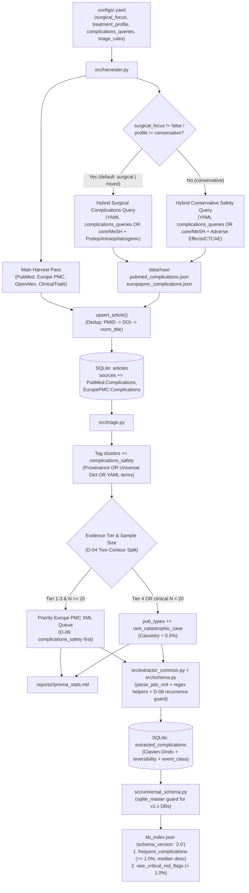

# Phase 17: Сбор, PRISMA-триаж и реляционная схема частых осложнений лечения - Research

**Researched:** 2026-11-19
**Domain:** Biomedical Literature Harvesting (`NCBI E-utilities` / `Europe PMC`), PRISMA 2020 Screening, SQLite Relational Schema (`Clavien–Dindo` / `CTCAE`), Universal Nosology JSON Schema (`v2.0` with `v1.x` Backward Compatibility)
**Confidence:** HIGH

<user_constraints>
## User Constraints (from CONTEXT.md)

### Locked Decisions

#### Генерация API-запросов и сбор корпуса по осложнениям (`harvester.py` & `configs/<id>.yaml`)
- **D-01:** Отдельный поисковый проход по осложнениям лечения в `src/harvester.py` включен **по умолчанию** для хирургических и смешанных (консервативно-хирургических) нозологий (`surgical_focus: true` по умолчанию / `treatment_profile: surgical | mixed`). Если в конфиге явно указан чисто терапевтический профиль (`surgical_focus: false` / `treatment_profile: conservative`), сборщик автоматически переключается на поисковый блок нежелательных лекарственных/консервативных явлений (`adverse effects / drug-related side effects`).
- **D-02:** Используется **гибридная сборка запросов**: если в `configs/<id>.yaml` задан блок `complications_queries` (`pubmed`, `europepmc`), `harvester.py` выполняет запросы из него (для захвата специфических осложнений конкретной операции); если блок отсутствует, `harvester.py` автоматически строит запрос из `core_terms` / `mesh_terms` нозологии в пересечении со стандартным хирургическим блоком осложнений (`"Postoperative Complications"[MeSH] OR "Intraoperative Complications"[MeSH] OR "iatrogenic"[tiab] OR "complication rate"[tiab] OR "adverse effects"[Subheading]` и аналогичным фильтром для `Europe PMC` в границах `date_range`).
- **D-03:** Выгрузка прицельного прохода кэшируется в отдельные файлы `data/<id>/raw/pubmed_complications.json` и `data/<id>/raw/europepmc_complications.json`, после чего дедуплицируется в общую таблицу `articles` (по `PMID -> DOI -> norm_title`) с добавлением маркеров провенанса `PubMed:Complications` и `EuropePMC:Complications` в JSON-массив `articles.sources`.

#### PRISMA-триаж частых осложнений против казуистики (`triage.py`)
- **D-04:** Вводится **двухконтурный учет** частоты и казуистики: количественные показатели «наиболее частых» осложнений (`%`) извлекаются строго из выборок `N >= 20` (мета-анализы, РКИ, регистры и когорты `evidence_tier IN (1, 2, 3)`), тогда как единичные клинические наблюдения (`Tier 4 Case Reports`, `N < 20`) маркируются отдельно как редкая хирургическая казуистика (`rare_catastrophic_case`, ориентир `< 0.5%`), чтобы не искажать частотный профиль рутинных вмешательств.
- **D-05:** Кластерный тег `complications_safety` в `articles.clusters` (с отдельным отображением в `reports/<id>/prisma_stats.md`) присваивается комбинированно: (а) всем включенным статьям с провенансом `PubMed:Complications` / `EuropePMC:Complications`, (б) статьям, совпавшим со встроенным универсальным хирургическим/терапевтическим словарем осложнений в `src/triage.py`, и (в) статьям, совпавшим со специфическими терминами осложнений из `configs/<id>.yaml` (`triage_rules.complication_terms` и `triage_rules.rare_complication_terms`).
- **D-06:** При скачивании открытых полнотекстовых XML из `Europe PMC` статьи `Tier 1–3` с кластерным тегом `complications_safety` получают повышенный приоритет очереди выгрузки, поскольку таблицы мелких и частых послеоперационных осложнений в `%` обычно находятся в разделе `Results` полного текста, а не в абстракте.

#### Реляционная схема `extracted_complications` и агрегация `frequent_complications` (`schema.py`, `extractor_common.py`, `universal_schema.py`)
- **D-07:** В таблице SQLite `extracted_complications` тяжесть кодируется по **двойной оси**: (1) универсальный хирургический стандарт `clavien_dindo_grade` (`I`, `II`, `IIIa`, `IIIb`, `IV`, `V`; для чисто консервативных модальностей — с маппингом `CTCAE Grade 1–5`) и (2) клиническая обратимость `reversibility` (`transient_self_limiting` — транзиторное самокупирующееся, `requires_conservative_therapy` — требует консервативного лечения/реабилитации, `requires_reoperation` — требует повторной операции/ревизии, `permanent_deficit` — стойкий функциональный или анатомический дефицит).
- **D-08:** Поле `event_class` разделяет записи на `true_complication` (инфекция, гематома, несостоятельность шва, КРБС, ятрогенная травма нерва/сосуда/связки/органа) и `transient_postop_sequela` (ожидаемые временные состояния послеоперационного ремоделирования — рубцовая болезненность, отек, преходящая тугоподвижность с фиксацией типичного срока разрешения в `time_window`). Рецидивы болезни и технически неполный релиз в `extracted_complications` не дублируются и остаются строго в контуре рецидивов/реинтервенций (`extracted_clinical_evidence` и поля `recurrence_*` в `modalities`).
- **D-09:** В `src/universal_schema.py` контракт `kb_index.json` (`schema_version: "2.0"`) включает основной массив `frequent_complications` (события с частотой `>= 1.0%` из когорт `Tier 1–3` при `N >= 20`, отсортированные по убыванию медианы частоты `frequency_median_num` в разрезе каждой лечебной модальности) и отдельный подблок `rare_critical_red_flags` (`< 1.0%`, тяжелые ятрогенные повреждения нервов, магистральных сосудов, сухожилий или полых органов). Для всех ранее собранных баз и отчетов `v1.x` гарантируется безошибочный fallback-режим (проверка существования таблицы `extracted_complications` через `sqlite_master` и мягкая обратная совместимость при отсутствии ключей `v2.0`).

### the agent's Discretion
- Точные имена вспомогательных хелперов и регулярных выражений в `src/extractor_common.py` для парсинга процентов частоты осложнений (`n/N (%)`), классов `Clavien–Dindo` и окон разрешения (`time_window`) из JATS XML и абстрактов.
- Точный лимит `retmax` / `pageSize` для дополнительного прохода осложнений в `src/harvester.py` (в разумных пределах API-квот, сопоставимо с основным проходом).
- Правила дедупликации и расчета медианы/диапазона (`min–max %`) при динамической сборке `frequent_complications` из SQLite в `build_dynamic_fallback_kb()` внутри `src/universal_schema.py`.

### Deferred Ideas (OUT OF SCOPE)
None — discussion stayed within phase scope. (Визуализация осложнений и форма создания нозологии в `app.py`, а также рендеринг новых секций в `.docx` относятся к Phase 19; структурный анти-ИИ линтер и правила нелинейных выводов — к Phase 18; существующие папки `prom`, `metroplasty_pregnancy`, `trigger_finger` не пересобираются и не модифицируются.)
</user_constraints>

<phase_requirements>
## Phase Requirements

| ID | Description | Research Support |
|----|-------------|------------------|
| **COMP-01** | Поддержка флага `surgical_focus: true/false` (и `treatment_profile`) и блока `complications_queries` (`pubmed`, `europepmc`) в YAML-конфигурации и `save_new_nosology_config()`; отдельный проход выгрузки осложнений в `src/harvester.py` с гибридной автогенерацией запросов, кэшем `pubmed_complications.json` / `europepmc_complications.json` и маркерами `PubMed:Complications` / `EuropePMC:Complications`. *(Примечание по границе фаз: виджеты вкладки 4 в `app.py` реализуются в Phase 19 по ROADMAP SC-2, а сериализация YAML-контракта закладывается в `universal_schema.py` и `harvester.py` в Phase 17).* | См. `Architecture Patterns` → Pattern 1 (`resolve_treatment_profile`, `build_complications_queries`, `harvest_pubmed_complications`, `harvest_europepmc_complications`) и переиспользование `upsert_article()` (`src/harvester.py:110-243`). |
| **COMP-02** | Разметка публикаций тегом `complications_safety` в `src/triage.py`, двухконтурное отделение когорт `Tier 1–3` (`N >= 20`) от казуистики `Tier 4` (`rare_catastrophic_case`), учет в `prisma_stats.md` и приоритетная выгрузка полнотекстовых XML из Europe PMC. | См. `Architecture Patterns` → Pattern 2 (`should_tag_complications_safety`, маркер `rare_catastrophic_case`, приоритетный `ORDER BY` в `download_fulltexts_tier1_to_3`, учет `pubmed_complications.json`/`europepmc_complications.json` в `generate_prisma_report`). |
| **COMP-03** | Таблица `extracted_complications` в `src/schema.py` (`CREATE TABLE IF NOT EXISTS`) и функции валидации/парсинга/записи/чтения в `src/extractor_common.py` с двойной осью тяжести (`clavien_dindo_grade` + `reversibility`), разделением `event_class` и запретом дублирования рецидивов. | См. `Architecture Patterns` → Pattern 3 (DDL таблицы с 15 обязательными и служебными колонками, `table_exists`, `insert_extracted_complication`, `fetch_extracted_complications`, парсеры `n/N (%)`, `Clavien–Dindo`/`CTCAE` и `time_window`). |
| **COMP-04** | Поддержка массива `frequent_complications` (`>= 1.0%`, `Tier 1–3`, `N >= 20`, сортировка по убыванию `frequency_median_num` внутри модальности) и `rare_critical_red_flags` (`< 1.0%`) в `src/universal_schema.py` со строгой проверкой для `v2.0` (`--schema-version v2`) и безошибочным read-only fallback для баз `v1.x`. | См. `Architecture Patterns` → Pattern 4 (`aggregate_complications_from_sqlite`, `validate_kb_complications_v2`, `--schema-version auto\|v1\|v2`, защита `sqlite_master` в `get_sqlite_corpus_stats` и `query_complications_df`). |
</phase_requirements>

---

## Summary

Фаза 17 закладывает серверное и схемное ядро Milestone `v2.0` для работы с осложнениями лечения в пяти модулях (`src/harvester.py`, `src/triage.py`, `src/schema.py`, `src/extractor_common.py`, `src/universal_schema.py`) без установки новых сторонних пакетов `[VERIFIED: codebase]`. Анализ текущей кодовой базы показал, что в `v1.x` сведения об осложнениях хранились лишь в неструктурированных текстовых полях (`extracted_clinical_evidence.complications_summary` / `complications_rate` и `modalities[].complications_profile`), а поисковые запросы ориентировались преимущественно на первичную эффективность и рецидивы `[VERIFIED: src/schema.py:68-92, src/universal_schema.py:44-64]`. В результате частые послеоперационные явления периода ремоделирования (рубцовая болезненность, отек, транзиторная тугоподвижность ПМФС на горизонте 3–6 месяцев) смешивались либо с истинными ятрогенными повреждениями, либо с рецидивами самой болезни, а казуистические `Case Reports` (`N = 1`) рисковали исказить популяционные оценки частоты.

Архитектура обновления строится вокруг четырех сцепленных механизмов (`D-01..D-09`): (1) гибридного дополнительного прохода выгрузки `PubMed` (`retmax=800`) и `Europe PMC` (`max_results=1000`) с раздельным кэшированием в `pubmed_complications.json` / `europepmc_complications.json` и дедупликацией через существующий `upsert_article()`; (2) комбинированного PRISMA-тегирования `complications_safety` с двухконтурной фильтрацией (`Tier 1–3` при `N >= 20` против казуистики `Tier 4` `rare_catastrophic_case`) и приоритетной докачкой полнотекстовых JATS XML, где содержатся таблицы `Results`; (3) новой таблицы SQLite `extracted_complications` с двойной шкалой тяжести (`clavien_dindo_grade` + `reversibility`), классификатором `event_class` (`true_complication` vs `transient_postop_sequela`) и жестким фильтром против дублирования рецидивов; (4) агрегатора и валидатора `kb_index.json` (`schema_version: "2.0"`), формирующего ранжированный по медиане массив `frequent_complications` (`>= 1.0%`) и блок `rare_critical_red_flags` (`< 1.0%`).

Проверка трех живых нозологий `v1.x` (`prom`, `metroplasty_pregnancy`, `trigger_finger`) подтвердила, что их файлы `data/<id>/literature.db` содержат ровно 4 пользовательские таблицы (`articles`, `clinical_trials`, `extracted_clinical_evidence`, `extracted_mechanisms`), а `kb_index.json` не имеют ключа `schema_version` `[VERIFIED: sqlite3 read-only probe]`. Следовательно, все читающие функции (`get_sqlite_corpus_stats`, `build_dynamic_fallback_kb`, `load_nosology_bundle`, `query_complications_df`) обязаны проверять наличие `extracted_complications` через `sqlite_master` и никогда не вызывать `init_db()` в режиме чтения, сохраняя бинарную неприкосновенность артефактов `v1.x`.

**Primary recommendation:** Реализовать Phase 17 в двух последовательных или частично параллельных планах: **Plan 17-01** — схема SQLite (`src/schema.py`), парсеры/CRUD-хелперы осложнений (`src/extractor_common.py`) и контракт/агрегатор `v2.0` + `v1.x` fallback (`src/universal_schema.py`); **Plan 17-02** — прицельный API-проход по осложнениям (`src/harvester.py`), PRISMA-триаж `complications_safety` с приоритетной очередью XML (`src/triage.py`) и полный модульно-интеграционный тест-пакет `tests/test_phase17_complications.py`.

---

## Architectural Responsibility Map

| Capability | Primary Tier | Secondary Tier | Rationale |
|------------|-------------|----------------|-----------|
| Разрешение профиля лечения (`surgical_focus` / `treatment_profile`) и гибридная генерация запросов по осложнениям (`D-01`, `D-02`) | **Ingestion / API Harvester** (`src/harvester.py`) | **Schema / Config Adapter** (`src/universal_schema.py`) | Сборщик формирует синтаксически валидные запросы для NCBI Entrez и Europe PMC REST API на основе YAML-конфига нозологии. |
| Кэширование сырых ответов осложнений и дедупликация с провенансом `*:Complications` (`D-03`) | **Ingestion / API Harvester** (`src/harvester.py`) | **Database / Storage** (`SQLite articles`) | Локальный сырой кэш (`raw/*_complications.json`) защищает от повторных сетевых вызовов, а `upsert_article()` сливает метаданные и массив `sources`. |
| PRISMA-скрининг, тег `complications_safety`, отсечение казуистики `Tier 4` (`N < 20`) и приоритет выгрузки JATS XML (`D-04`, `D-05`, `D-06`) | **Screening & Triage Engine** (`src/triage.py`) | **Markdown Reporting** (`prisma_stats.md`) | Триаж управляет фильтрацией корпуса, очередью `ThreadPoolExecutor` для Europe PMC XML и формированием воронки PRISMA 2020. |
| Хранение, валидация `Clavien–Dindo` / `CTCAE` / `reversibility` / `event_class` и парсинг частот из JATS XML (`D-07`, `D-08`) | **Database & Extraction Core** (`src/schema.py`, `src/extractor_common.py`) | — | Реляционный уровень гарантирует целостность колонок, нормализацию градаций тяжести и блокировку записи рецидивов в таблицу осложнений. |
| Медианная агрегация `frequent_complications` (`>= 1%`) vs `rare_critical_red_flags` (`< 1%`) и обратная совместимость с `v1.x` (`D-09`) | **Universal Schema Adapter** (`src/universal_schema.py`) | **Database / Storage** (`sqlite_master` read-only check) | Единый адаптер обслуживает `kb_index.json`, `verify_reports.py` (Phase 18) и `app.py` / `docx_exporter.py` (Phase 19), изолируя различия схем `v1.x` и `v2.0`. |

---

## Standard Stack

Фаза 17 **не требует установки новых внешних библиотек** и полностью опирается на стандартную библиотеку Python 3.12 и уже задекларированные в PEP 723 (`# /// script`) зависимости проекта `[VERIFIED: codebase & uv runtime]`.

### Core

| Library | Version | Purpose | Why Standard |
|---------|---------|---------|--------------|
| `Python` (managed via `uv`) | `3.12.16` `[VERIFIED: uv runtime]` | Среда исполнения всех скриптов пайплайна | Зафиксирована в inline-заголовках PEP 723 (`>=3.11,<3.14`) во всех модулях `src/`. |
| `sqlite3` (stdlib) | `3.53.1` `[VERIFIED: uv runtime]` | Реляционное хранение корпуса и таблицы `extracted_complications` в режиме WAL | Встроена в Python, поддерживает `CREATE TABLE IF NOT EXISTS`, `sqlite_master` интроспекцию и URI read-only подключения. |
| `xml.etree.ElementTree` + `re` + `statistics` (stdlib) | Python `3.12` stdlib `[VERIFIED: uv runtime]` | Парсинг секций/таблиц JATS XML (`parse_jats_xml`), извлечение `n/N (%)` и расчет медиан частот (`statistics.median`) | Нулевые накладные расходы, детерминированная обработка локальных XML Europe PMC. |
| `PyYAML` | `6.0.3` `[VERIFIED: uv runtime]` | Чтение/запись профилей `configs/<id>.yaml` (`surgical_focus`, `complications_queries`, `triage_rules`) | Штатный парсер конфигураций во всех фазах пайплайна (`yaml.safe_load` / `yaml.safe_dump`). |
| `pandas` | `3.1.1` `[VERIFIED: uv runtime]` | Табличные выборки SQLite (`query_complications_df`) и сериализация CSV (`utf-8-sig`) в `src/universal_schema.py` | Уже используется в `src/universal_schema.py` и `app.py`. |
| `polite-http` + `truststore` | `0.1.4` / `0.10.5` `[VERIFIED: uv runtime]` | Rate-limited HTTP-клиент научных скиллов (`pubmed_api.py`, `europepmc_api.py`) и системное TLS-хранилище Windows | Обязательны при импорте `src/harvester.py` и `src/triage.py` (`truststore.inject_into_ssl()`). |

### Supporting (Testing)

| Library | Version | Purpose | When to Use |
|---------|---------|---------|-------------|
| `pytest` | `9.2.0` `[VERIFIED: uv runtime]` | Запуск модульных, схемных и регрессионных автотестов Фазы 17 | Вызывается эфемерно через `uv run --with pytest ...` (так как в репозитории нет глобального `pyproject.toml`). |
| `markdown` | `3.11.3` `[VERIFIED: uv runtime]` | Генерация печатного HTML в `src/universal_schema.py` | Требуется в окружении `uv run` при импорте `src.universal_schema` в тестах. |

### Alternatives Considered

| Instead of | Could Use | Tradeoff |
|------------|-----------|----------|
| `statistics.median` (stdlib) для расчета `frequency_median_num` | `numpy.median` / `pandas.Series.median` | `statistics.median` работает на чистых списках `float` без создания `DataFrame` внутри `build_dynamic_fallback_kb()` и не тянет лишних зависимостей в `extractor_common.py`. |
| Раздельные файлы `pubmed_complications.json` и `europepmc_complications.json` | Пакетные файлы `europepmc_page_*.json` | Раздельные файлы жестко зафиксированы в **D-03** и предотвращают конфликт с `glob("europepmc_page_*.json")` основного прохода. |

**Execution & Test Command (PEP 723 repo without `pyproject.toml`):**
```powershell
$env:PATH = "$HOME\.local\bin;" + $env:PATH
uv run --with pytest --with pyyaml --with pandas --with markdown --with truststore pytest tests/test_phase17_complications.py -q
```

---

## Architecture Patterns

### System Architecture Diagram



### Component Responsibilities & Exact Modification Targets

| File | Existing Anchor Lines | Phase 17 Additions / Changes |
|------|-----------------------|------------------------------|
| `src/schema.py` | `init_db()` (`lines 5-111`) | Добавить `CREATE TABLE IF NOT EXISTS extracted_complications (...)` и индексы `idx_ext_comp_article`, `idx_ext_comp_modality`, `idx_ext_comp_grade`, `idx_ext_comp_class` внутри `cur.executescript(...)`. |
| `src/extractor_common.py` | `parse_jats_xml()` (`lines 66-135`), `extract_sample_size()` (`lines 137-183`) | Расширить заголовки секций безопасности в `parse_jats_xml()`; добавить константы и валидаторы `VALID_CLAVIEN_DINDO`, `VALID_REVERSIBILITY`, `VALID_EVENT_CLASS`, маппер `CTCAE -> Clavien–Dindo`, анти-рецидивный фильтр `is_excluded_recurrence_event()` (`D-08`), regex-парсеры `extract_complication_frequency()`, `extract_clavien_dindo_grade()`, `extract_resolution_time_window()`, проверку `table_exists()` и CRUD-функции `insert_extracted_complication()`, `fetch_extracted_complications()`. |
| `src/harvester.py` | `upsert_article()` (`lines 110-243`), `harvest_pubmed()` (`lines 245-330`), `harvest_europepmc()` (`lines 333-413`), `main()` (`lines 617-668`) | Добавить `resolve_treatment_profile(cfg)` (`D-01`), `build_complications_queries(cfg)` (`D-02`), `harvest_pubmed_complications()` и `harvest_europepmc_complications()` с кэшем в `pubmed_complications.json` и `europepmc_complications.json` и провенансом `PubMed:Complications` / `EuropePMC:Complications` (`D-03`); подключить вызов в `main()` с выводом сводки. |
| `src/triage.py` | `RARE_COMPLICATION_TERMS` (`lines 107-126`), `classify_evidence_tier()` (`lines 194-326`), `assign_clusters()` (`lines 329-337`), `download_fulltexts_tier1_to_3()` (`lines 348-441`), `generate_prisma_report()` (`lines 444-634`), `main()` (`lines 665-714`) | Добавить универсальные словари хирургических и консервативных осложнений; расширить выборку `SELECT ... sources` в `main()`; внедрить комбинированное присвоение тега `complications_safety` (`D-05`) и маркера `rare_catastrophic_case` для `Tier 4` / клинических серий `N < 20` (`D-04`); поднять приоритет `complications_safety` в `download_fulltexts_tier1_to_3()` (`D-06`); добавить учет `*_complications.json` и строку `complications_safety` в `generate_prisma_report()`. |
| `src/universal_schema.py` | `PROJECT_ROOT` (`line 28`), `get_sqlite_corpus_stats()` (`lines 98-145`), `build_dynamic_fallback_kb()` (`lines 147-290`), `load_nosology_bundle()` (`lines 291-363`), `save_new_nosology_config()` (`lines 640-649`), `verify_universal_schema()` (`lines 652-726`) | Вставить `PROJECT_ROOT` в `sys.path`; защитить чтение `extracted_complications` проверкой `sqlite_master` в `get_sqlite_corpus_stats()` и новой `query_complications_df()`; реализовать `aggregate_complications_from_sqlite()` для `build_dynamic_fallback_kb()` (`frequent_complications` `>= 1.0%` + `rare_critical_red_flags` `< 1.0%`); добавить `validate_kb_complications_v2()` и аргумент `--schema-version auto\|v1\|v2` (`D-09`, `COMP-04`). |

---

### Pattern 1: Гибридная генерация запросов и прицельный сбор осложнений (`D-01`, `D-02`, `D-03`)

**What:** Разрешение лечебного профиля нозологии с хирургическим дефолтом, автоматическая сборка пересечения «ядро нозологии AND блок осложнений» при отсутствии ручного `complications_queries` и изолированное кэширование в два JSON-файла.
**When to use:** При каждом запуске `src/harvester.py --config configs/<id>.yaml`.

**Конкретные правила реализации:**
1. **Определение профиля (`resolve_treatment_profile(cfg)`):**
   - Читает `treatment_profile` и `surgical_focus` как с верхнего уровня YAML, так и из вложенного словаря `cfg.get("nosology", {})` (поскольку `configs/trigger_finger.yaml` дублирует метаданные на обоих уровнях, а `app.py:971` пишет их внутрь `nosology:`) `[VERIFIED: configs/trigger_finger.yaml:1-25, app.py:971-987]`.
   - Если `str(treatment_profile).lower() == "conservative"` или `surgical_focus is False` → возвращает `"conservative"`.
   - Во всех остальных случаях (по умолчанию, включая отсутствие ключей, `surgical_focus: true`, `treatment_profile: "surgical" | "mixed"`) → возвращает `"surgical"`.
2. **Гибридная сборка запросов (`build_complications_queries(cfg)`):**
   - Если задан `cfg["complications_queries"]["pubmed"]` / `["europepmc"]` — берется готовая строка из YAML.
   - Если блок (или один из ключей) отсутствует — конструируется ядро нозологии из `mesh_terms` (`"Term"[MeSH Terms]` для PubMed) и первых 8 терминов `triage_rules.core_terms` (`"term"[Title/Abstract]` для PubMed; `"term"` для Europe PMC; при их отсутствии — `name_en`).
   - Пересекается (`AND`) со стандартным блоком:
     - `surgical`: `("Postoperative Complications"[MeSH] OR "Intraoperative Complications"[MeSH] OR "Iatrogenic Disease"[MeSH] OR "iatrogenic"[tiab] OR "complication rate"[tiab] OR "adverse effects"[Subheading] OR "complications"[Subheading] OR "Clavien-Dindo"[tiab] OR "reoperation"[tiab])` (и текстовый эквивалент для Europe PMC).
     - `conservative`: `("Drug-Related Side Effects and Adverse Reactions"[MeSH] OR "adverse effects"[Subheading] OR "toxicity"[Subheading] OR "adverse events"[tiab] OR "drug-related side effects"[tiab] OR "CTCAE"[tiab])`.
   - Ограничивается `date_range` (`YYYY/MM/DD` для PubMed, `FIRST_PDATE:[YYYY-MM-DD TO YYYY-MM-DD]` для Europe PMC).
3. **Квоты API и структура кэша (`Discretion` + `D-03`):**
   - Для `PubMed:Complications`: `max_results=800`, `sort_by="relevance"`, батчи `fetch_article_abstracts` и `fetch_database_summary` по `180` PMID, сохранение единого объекта `{"query": ..., "profile": ..., "pmids": [...], "records": [...]}` в `data/<id>/raw/pubmed_complications.json`. При повторном запуске чтение идет мгновенно из этого файла без сетевых вызовов.
   - Для `EuropePMC:Complications`: `max_results=1000` (1 страница `result_type="core"` через `epmc_mod.search`), сохранение в `data/<id>/raw/europepmc_complications.json`.
   - Каждая запись передается в существующий `upsert_article(conn, rec)` с `"sources": ["PubMed:Complications"]` или `["EuropePMC:Complications"]`. Функция `upsert_article()` (`src/harvester.py:209-214`) уже объединяет `old_sources + new_sources` через `dict.fromkeys` `[VERIFIED: src/harvester.py:213]`.

---

### Pattern 2: Двухконтурный PRISMA-триаж и приоритетная очередь Europe PMC XML (`D-04`, `D-05`, `D-06`)

**What:** Разделение репрезентативных выборок (`Tier 1–3`, `N >= 20`) и единичной казуистики (`Tier 4`, `N < 20`), комбинированное присвоение кластера `complications_safety` и продвижение полнотекстовых статей об осложнениях в начало очереди загрузки XML.

**Конкретные правила реализации:**
1. **Проверка контекста при PRISMA-скрининге (`classify_prisma_status`):**
   - Статьи с провенансом `PubMed:Complications` / `EuropePMC:Complications` обязаны содержать `core_terms` нозологии (чтобы не пропустить нерелевантные операции), но при проверке `context_terms` совпадение со словарем осложнений засчитывается как валидный клинический контекст, чтобы узкоспецифические статьи о ятрогенных травмах не отсеивались в `excluded_offtopic`.
2. **Двухконтурное разделение `Tier 1–3` (`N >= 20`) vs `rare_catastrophic_case` (`D-04`):**
   - Если статья классифицирована в `Tier 4` (`case reports`, `a case of`, `two cases of` и т.д.), либо является клиническим описанием малой серии с явно извлеченным `1 <= n_patients < 20` (при отсутствии `n_joints >= 20`, признаков `Tier 1` РКИ/метаанализа и фундаментальных *in vitro*/*ex vivo* маркеров `in vitro`, `cell line`, `scrna-seq`, `biopsy`, `histolog`), она относится к `Tier 4`.
   - При наличии терминов осложнений такой `Tier 4` записи в массив `pub_types` добавляется маркер `"rare_catastrophic_case"` (наряду с сохранением `"Rare Complication Case [D-05]"` для совместимости со счетчиком в `prisma_stats.md:500`).
3. **Комбинированный тег `complications_safety` (`D-05`):**
   - Присваивается любой включенной (`prisma_status == 'included'`) статье при выполнении хотя бы одного из трех условий:
     - `(a)` в JSON-массиве `articles.sources` присутствует `"PubMed:Complications"` или `"EuropePMC:Complications"`;
     - `(b)` `title + abstract` содержит термин из встроенного универсального словаря (`UNIVERSAL_SURGICAL_COMPLICATION_TERMS` / `UNIVERSAL_CONSERVATIVE_ADVERSE_TERMS`);
     - `(c)` `title + abstract` содержит термин из `triage_rules.complication_terms` или `triage_rules.rare_complication_terms`.
4. **Приоритетная выгрузка XML (`download_fulltexts_tier1_to_3`, `D-06`):**
   - При бюджете `--max-xml 200` (`src/triage.py:640`) стандартная сортировка `ORDER BY evidence_tier ASC, cited_by_count DESC` отдает весь лимит общим статьям `Tier 1–2`, оставляя `Tier 3` когорты с таблицами осложнений без XML (например, в `trigger_finger` скачано `0` XML из `283` OA-статей `Tier 3`) `[VERIFIED: reports/trigger_finger/prisma_stats.md:23]`.
   - Новый порядок кандидатов: (1) подтвержденное наличие в Europe PMC (`"EuropePMC"` или `"EuropePMC:Complications"` в распарсенном `sources`), (2) `Tier 1–3` перед `Tier 4`, (3) внутри `Tier 1–3` **сначала статьи с тегом `complications_safety`**, затем остальные, по `evidence_tier ASC, cited_by_count DESC`.

---

### Pattern 3: Реляционная таблица `extracted_complications` и защита от дублирования рецидивов (`COMP-03`, `D-07`, `D-08`)

**What:** Строгая схема хранения осложнений с двойной осью тяжести и программным фильтром против смешения осложнений с рецидивами основного заболевания.

**Точная DDL-схема в `src/schema.py`:**
```sql
CREATE TABLE IF NOT EXISTS extracted_complications (
    id INTEGER PRIMARY KEY AUTOINCREMENT,
    article_id INTEGER REFERENCES articles(id),
    pmid TEXT,
    doi TEXT,
    first_author_year TEXT,
    evidence_tier INTEGER,
    modality TEXT NOT NULL,
    complication_name TEXT NOT NULL,
    event_class TEXT NOT NULL DEFAULT 'true_complication',
    timing_category TEXT,
    clavien_dindo_grade TEXT NOT NULL,
    ctcae_grade TEXT,
    frequency_pct TEXT,
    frequency_num REAL,
    reversibility TEXT NOT NULL,
    time_window TEXT,
    anatomical_substrate TEXT,
    prevention_and_management TEXT,
    sample_size INTEGER,
    is_rare_casuistry INTEGER DEFAULT 0
);

CREATE INDEX IF NOT EXISTS idx_ext_comp_article ON extracted_complications(article_id);
CREATE INDEX IF NOT EXISTS idx_ext_comp_modality ON extracted_complications(modality);
CREATE INDEX IF NOT EXISTS idx_ext_comp_grade ON extracted_complications(clavien_dindo_grade);
CREATE INDEX IF NOT EXISTS idx_ext_comp_class ON extracted_complications(event_class);
```

**Правила нормализации и контроля (`src/extractor_common.py`):**
- **Ось 1 (`clavien_dindo_grade` + маппинг `CTCAE` по `D-07`):** допустимое множество `("I", "II", "IIIa", "IIIb", "IV", "V")` (подклассы `IVa`/`IVb` нормализуются в `"IV"`, одиночный `"III"` без литеры — в `"IIIa"` при местной анестезии/пункции или `"IIIb"` при реоперации). Для консервативных/медикаментозных модальностей `CTCAE Grade 1 -> I`, `Grade 2 -> II`, `Grade 3 -> IIIa`, `Grade 4 -> IV`, `Grade 5 -> V` с сохранением исходного значения в `ctcae_grade`.
- **Ось 2 (`reversibility` по `D-07`):** строго `("transient_self_limiting", "requires_conservative_therapy", "requires_reoperation", "permanent_deficit")`.
- **Класс события (`event_class` по `D-08`):** строго `("true_complication", "transient_postop_sequela")`. Для `transient_postop_sequela` (послеоперационный отек, болезненность рубца, транзиторный дефицит разгибания/тугоподвижность в фазе ремоделирования) поле `time_window` обязательно непустое (либо заполняется дефолтом из парсера, например `"Разрешение в фазе ремоделирования (требует уточнения срока)"`).
- **Блокировка рецидивов (`is_excluded_recurrence_event` по `D-08`):** попытка записать в `extracted_complications` чистый рецидив болезни или технически неполный релиз (`true recurrence`, `disease relapse`, `incomplete release`, `persistent triggering`, `истинный рецидив`, `неполное рассечение`) отклоняется (`ValueError` в строгом режиме или возврат `None` при `skip_recurrence=True`).
- **Защита от искажения процента в казуистике (`D-04`):** если `evidence_tier == 4` или `(sample_size is not None and sample_size < 20)`, автоматически выставляется `is_rare_casuistry = 1`; если при этом `sample_size < 20` и парсер извлек `100%` (типичное `1/1 (100%)` в одиночном кейс-репорте), `frequency_num` обнуляется в `None`, чтобы `100.0` никогда не попало в численные агрегаты.

---

### Pattern 4: Агрегация `frequent_complications` и обратная совместимость с `v1.x` (`COMP-04`, `D-09`)

**What:** Расчет медианы и диапазона (`min–max %`) частот по когортам `Tier 1–3` (`N >= 20`) в `src/universal_schema.py`, разделение по порогу `1.0%` на `frequent_complications` и `rare_critical_red_flags` и безопасное чтение архивных баз `v1.x`.

**Алгоритм агрегации в `aggregate_complications_from_sqlite(db_path)` (`Discretion` + `D-09`):**
1. Проверить `db_path.exists()` и наличие таблицы `extracted_complications` в `sqlite_master`. Если таблицы нет — вернуть `([], [])` без создания таблиц и без записи на диск.
2. Выбрать строки `extracted_complications` (присоединив `articles` через `LEFT JOIN` для отсева `prisma_status != 'included'`).
3. Сгруппировать по нормализованному ключу `(modality.strip().lower(), complication_name.strip().lower())`.
4. **Контур когорт (`evidence_tier IN (1, 2, 3)` И `sample_size >= 20` И `is_rare_casuistry == 0` И `frequency_num IS NOT NULL`):**
   - Вычислить `med = round(statistics.median(freqs), 2)`, `f_min = round(min(freqs), 2)`, `f_max = round(max(freqs), 2)`.
   - Сформировать `frequency_pct`: `f"{med:g}%"` при одном значении или `f_min == f_max`, иначе `f"{med:g}% ({f_min:g}–{f_max:g}%)"`.
   - Суммировать `sample_size` по уникальным `article_id` (`sample_size_total`), собрать уникальные `evidence_pmids`.
   - Если `med >= 1.0` → включить в `frequent_complications` с полем `"frequency_median_num": med`.
   - Если `med < 1.0` и событие тяжелое (`clavien_dindo_grade in ("IIIa", "IIIb", "IV", "V")` или `reversibility in ("requires_reoperation", "permanent_deficit")`) → включить в `rare_critical_red_flags` с `"frequency_max_num": f_max`.
5. **Контур казуистики (`Tier 4` / `sample_size < 20` / `is_rare_casuistry == 1`):**
   - Никогда не попадает в `frequent_complications`.
   - Если пара `(modality, complication_name)` отсутствует в `frequent_complications` и имеет тяжесть `IIIa–V` или `requires_reoperation` / `permanent_deficit`, добавляется в `rare_critical_red_flags` с `frequency_pct = "< 0.5% (единичные клинические наблюдения Tier 4)"` и `frequency_max_num = 0.49`.
6. **Сортировка (`D-09`):** `frequent_complications` сортируется по модальности и строго по убыванию `frequency_median_num`: `key=lambda r: (modality_order.get(r["modality"], 999), r["modality"], -float(r["frequency_median_num"]))`.

**Режимы валидации в `verify_universal_schema(nosology_id, schema_version="auto")`:**
- `schema_version == "v1"` или (`"auto"` и `kb.get("schema_version") != "2.0"`): мягкий режим `v1.x` — отсутствие `frequent_complications` и `rare_critical_red_flags` в `prom`, `metroplasty_pregnancy`, `trigger_finger` считается штатным и проходит проверку `[PASS]`.
- `schema_version == "v2"` или (`"auto"` и `str(kb.get("schema_version")) == "2.0"`): строгий режим `v2.0` — вызывается `validate_kb_complications_v2(kb)`, проверяющий наличие непустого `frequent_complications`, обязательных полей, допустимых значений `Clavien–Dindo` / `reversibility` / `event_class`, порога `frequency_median_num >= 1.0`, `sample_size_total >= 20`, убывающей сортировки внутри каждой модальности, отсутствия рецидивов в осложнениях и валидности `rare_critical_red_flags` (`< 1.0%`).

---

### Anti-Patterns to Avoid

- **Вызов `init_db(db_path)` внутри `get_sqlite_corpus_stats()`, `load_nosology_bundle()` или `query_complications_df()`:** модифицирует файлы `data/prom/literature.db`, `data/metroplasty_pregnancy/literature.db` и `data/trigger_finger/literature.db` прямо при открытии `app.py`, нарушая жесткий запрет на изменение артефактов `v1.x`. Читающие функции используют только `sqlite3.connect(...)` + проверку `sqlite_master`.
- **Запись страниц осложнений Europe PMC в шаблон `europepmc_page_*.json`:** смешает кэш основного прохода и прохода осложнений и нарушит требование **D-03** (`europepmc_complications.json`).
- **Наивная проверка `"EuropePMC" in json.loads(sources)` как точного равенства:** статьи, пришедшие только из прохода осложнений, имеют в массиве `"EuropePMC:Complications"`. Проверять нужно `any(s in ("EuropePMC", "EuropePMC:Complications") for s in src_list)`.
- **Усреднение процента `1/1 (100%)` из `Tier 4 Case Report` в общую выборку:** превращает редчайшую ятрогенную катастрофу (`< 0.5%`) в мнимое `50–100%` осложнение. Двухконтурный барьер `evidence_tier IN (1, 2, 3) AND sample_size >= 20` (**D-04**) обязателен как на этапе записи (`is_rare_casuistry`), так и в SQL/Python-агрегаторе.

---

## Don't Hand-Roll

| Problem | Don't Build | Use Instead | Why |
|---------|-------------|-------------|-----|
| HTTP-запросы с троттлингом к NCBI Entrez и Europe PMC | Собственные `urllib`/`requests` циклы с `time.sleep` для поиска статей | `load_skill_module("pubmed_api", PUBMED_SCRIPT)` и `load_skill_module("europepmc_api", EPMC_SCRIPT)` в `src/harvester.py:47-53` | Штатные обертки скиллов уже используют `polite-http` (`3/10 QPS` с учетом `NCBI_API_KEY`, авто-ретраи и парсинг `PubmedArticle` XML) `[VERIFIED: pubmed_api.py:54-60]`. |
| Дедупликация статей между основным проходом и проходом осложнений | Отдельную таблицу временных статей или ручной SQL-мерж | Существующую `upsert_article(conn, rec)` в `src/harvester.py:110-243` | Уже реализует каскад `PMID -> DOI -> norm_title`, выбирает более длинный абстракт, снимает флаг препринта при выходе журнальной версии и объединяет JSON-список `sources` без дублей. |
| Парсинг JATS XML и извлечение объема выборки `N` | Новый XML-парсер с нуля | Расширенный `parse_jats_xml()` и `extract_sample_size()` в `src/extractor_common.py:66-183` | Уже извлекает секции и собирает строки `table-wrap` через разделитель `" \| "`, пригодный для регулярных выражений `n/N (%)`. |
| Расчет медианы частот | Ручную индексную арифметику четных/нечетных списков | `statistics.median()` из стандартной библиотеки Python | Корректно обрабатывает списки четной и нечетной длины и `float`/`int` элементы. |

**Key insight:** Вся сетевая, дедупликационная и XML-инфраструктура в репозитории уже отлажена на четырех милстоунах (`v1.x`); задача Phase 17 — аккуратно встроить второй контур безопасности в существующие точки расширения, не дублируя транспортный слой.

---

## Common Pitfalls

### Pitfall 1: Отсутствие `PROJECT_ROOT` в `sys.path` при прямом CLI-вызове `src/universal_schema.py`
**What goes wrong:** Команда `uv run src/universal_schema.py --verify --nosology prom` падает с `ModuleNotFoundError: No module named 'src'` на строке 696 (`from src.docx_exporter import build_docx_bytes_from_markdown`) `[VERIFIED: PowerShell probe]`.
**Why it happens:** В отличие от `src/harvester.py:37` и `src/triage.py:36`, в `src/universal_schema.py:28` переменная `PROJECT_ROOT` вычисляется, но не добавляется в `sys.path`. При импорте из `app.py` корень уже в `sys.path`, а при прямом запуске скрипта — нет.
**How to avoid:** Сразу после `PROJECT_ROOT = Path(__file__).resolve().parent.parent` в `src/universal_schema.py` добавить `if str(PROJECT_ROOT) not in sys.path: sys.path.insert(0, str(PROJECT_ROOT))`.
**Warning signs:** Падение CLI `uv run src/universal_schema.py --verify` без выставленного `PYTHONPATH=.`.

### Pitfall 2: Искажение счетчика `duplicates_removed` в `prisma_stats.md` после добавления прохода осложнений
**What goes wrong:** В `generate_prisma_report()` (`src/triage.py:454-475`) число сырых записей `total_raw` считается только по `pubmed_pmids.json`, `europepmc_page_*.json` и `openalex_page_*.json`. Если `pubmed_complications.json` и `europepmc_complications.json` добавят новые статьи в `articles`, `total_unique` вырастет, а `total_raw` — нет, что занизит `duplicates_removed` вплоть до `0`.
**How to avoid:** В `generate_prisma_report()` дополнительно считывать длину `pmids` из `pubmed_complications.json` и длину `results` из `europepmc_complications.json` (если файлы существуют), прибавляя их к `total_raw` и отображая детализацию в узле `A` диаграммы PRISMA. Для папок `v1.x`, где этих файлов нет, прирост равен `0`.
**Warning signs:** В `prisma_stats.md` сумма `PubMed + Europe PMC + OpenAlex` меньше, чем `total_unique`.

### Pitfall 3: Падение `pytest` с `ModuleNotFoundError: No module named 'truststore'`
**What goes wrong:** Запуск `uv run --with pytest ...` без `--with truststore` падает при импорте `src.harvester` или `src.triage`, так как оба модуля вызывают `import truststore; truststore.inject_into_ssl()` на уровне модуля (`src/harvester.py:32`, `src/triage.py:31`) `[VERIFIED: uv runtime probe]`.
**How to avoid:** Всегда включать `--with truststore` в команду запуска `pytest` (либо дополнительно обернуть `truststore` в безопасный хелпер, но сохраняя `--with truststore` в тестовой команде).
**Warning signs:** Ошибка импорта еще на фазе `collection` в `pytest`.

### Pitfall 4: Ложное срабатывание парсера процентов на `95% CI` и `100% follow-up`
**What goes wrong:** Простая регулярка `\d+(?:\.\d+)?%` захватывает `"95% CI"` как частоту осложнения `95.0%` или `"100% complete release"` как `100.0%`.
**Why it happens:** В медицинских абстрактах доверительные интервалы и полнота наблюдения встречаются в одном предложении с осложнениями.
**How to avoid:** В `extract_complication_frequency()` использовать негативный просмотр вперед `(?!\s*(?:CI|confidence\s+interval|ДИ))` и приоритезировать паттерн дроби `n/N (X.Y%)` / `X.Y% (n/N)`.
**Warning signs:** Медианы частот осложнений внезапно группируются около `95.0%`.

### Pitfall 5: Разночтение структуры YAML-ключей (`cfg["nosology_id"]` vs `cfg["nosology"]["id"]`)
**What goes wrong:** Конфигуратор вкладки 4 в `app.py:971-987` сохраняет идентификатор и MeSH только внутри блока `nosology:` (`nosology.id`, `nosology.mesh_terms`), тогда как ручные конфиги (`prom.yaml`, `trigger_finger.yaml`) содержат их и на верхнем уровне, и внутри `nosology:`.
**How to avoid:** Во всех новых функциях `src/harvester.py` (`resolve_treatment_profile`, `build_complications_queries`) и `src/universal_schema.py` читать метаданные с двухуровневым fallback: `cfg.get("key") if "key" in cfg else cfg.get("nosology", {}).get("key")`.
**Warning signs:** `KeyError: 'nosology_id'` при запуске `harvester.py` на конфиге, сгенерированном через форму `app.py`.

---

## Environment Availability

Проверка выполнена инструментально в рабочей среде Windows PowerShell (`2026-11-19`) `[VERIFIED: PowerShell probe]`:

| Dependency | Required By | Available | Version | Fallback |
|------------|------------|-----------|---------|----------|
| `uv` (`~/.local/bin/uv.exe`) | Запуск всех PEP 723 скриптов и тестов | ✓ | `0.13.7` | — (обязательно добавлять `$HOME\.local\bin` в `$env:PATH` в каждой сессии PowerShell) |
| Managed `Python` (`uv run python`) | Исполнение `src/*.py` и `pytest` | ✓ | `3.12.16` | Глобальный `python` в системном `PATH` отсутствует (`CommandNotFoundException`) — вызывать **только** через `uv run python`! |
| `SQLite` (`sqlite3` в Python 3.12) | Схема `extracted_complications` и чтение баз `v1.x` | ✓ | `3.53.1` | — |
| `pytest` (через `uv run --with pytest`) | Модульные и регрессионные автотесты | ✓ | `9.2.0` | — |
| Скиллы `pubmed_api.py` & `europepmc_api.py` | Сетевой сбор в `src/harvester.py` | ✓ | Локально в `~/.gemini/config/plugins/science/skills/` | В автотестах мокируются (`monkeypatch`) для детерминированного офлайн-прогона `< 5 с` |
| Эталонные базы `v1.x` (`prom`, `metroplasty_pregnancy`, `trigger_finger`) | Read-only регрессионный контроль обратной совместимости (`D-09`) | ✓ | `4474` / `775` / `1682` статей в SQLite | — |

**Missing dependencies with no fallback:**
- Нет блокирующих зависимостей.

**Missing dependencies with fallback:**
- Глобальный бинарник `python` отсутствует в системном `PATH` Windows; штатная замена — `uv run python ...` с предварительным `$env:PATH = "$HOME\.local\bin;" + $env:PATH`.

---

## Code Examples

Проверенные паттерны, согласованные с сигнатурами текущей кодовой базы:

### 1. Разрешение профиля лечения и гибридная генерация запросов (`src/harvester.py`, `D-01..D-03`)
```python
# Source: Adapted to src/harvester.py conventions & locked decisions D-01..D-03
SURGICAL_PUBMED_COMP_BLOCK = (
    '("Postoperative Complications"[MeSH] OR "Intraoperative Complications"[MeSH] '
    'OR "Iatrogenic Disease"[MeSH] OR "iatrogenic"[tiab] OR "complication rate"[tiab] '
    'OR "adverse effects"[Subheading] OR "complications"[Subheading] '
    'OR "Clavien-Dindo"[tiab] OR "nerve injury"[tiab] OR "surgical site infection"[tiab] '
    'OR "reoperation"[tiab])'
)

SURGICAL_EPMC_COMP_BLOCK = (
    '("postoperative complications" OR "intraoperative complications" OR "iatrogenic" '
    'OR "complication rate" OR "Clavien-Dindo" OR "surgical complication" '
    'OR "adverse effects" OR "nerve injury" OR "reoperation")'
)

CONSERVATIVE_PUBMED_COMP_BLOCK = (
    '("Drug-Related Side Effects and Adverse Reactions"[MeSH] OR "adverse effects"[Subheading] '
    'OR "toxicity"[Subheading] OR "adverse events"[tiab] OR "drug-related side effects"[tiab] '
    'OR "side effects"[tiab] OR "treatment-related adverse"[tiab] OR "CTCAE"[tiab])'
)

CONSERVATIVE_EPMC_COMP_BLOCK = (
    '("adverse effects" OR "drug-related side effects" OR "adverse events" '
    'OR "side effects" OR "toxicity" OR "CTCAE" OR "treatment-emergent adverse")'
)


def resolve_treatment_profile(cfg: dict[str, Any]) -> str:
    """Return 'conservative' only when explicitly configured; default to 'surgical' (D-01)."""
    meta = cfg.get("nosology") or {}
    profile = str(cfg.get("treatment_profile") or meta.get("treatment_profile") or "").strip().lower()
    if profile == "conservative":
        return "conservative"
    if "surgical_focus" in cfg and cfg["surgical_focus"] is False:
        return "conservative"
    if "surgical_focus" in meta and meta["surgical_focus"] is False:
        return "conservative"
    return "surgical"


def build_complications_queries(cfg: dict[str, Any]) -> dict[str, str]:
    """Return explicit or auto-generated PubMed & Europe PMC complication queries (D-01, D-02)."""
    explicit = cfg.get("complications_queries") or {}
    profile = resolve_treatment_profile(cfg)
    meta = cfg.get("nosology") or {}
    date_range = cfg.get("date_range") or {}
    start_year = int(date_range.get("start_year", 2016))
    end_year = int(date_range.get("end_year", 2026))
    start_date = str(date_range.get("start_date") or f"{start_year}-01-01")
    end_date = str(date_range.get("end_date") or f"{end_year}-12-31")

    mesh_terms = cfg.get("mesh_terms") or meta.get("mesh_terms") or []
    core_terms = ((cfg.get("triage_rules") or {}).get("core_terms") or [])[:8]
    fallback_name = cfg.get("name_en") or meta.get("name_en") or cfg.get("nosology_id") or meta.get("id") or ""

    pm_disease_parts = [f'"{m}"[MeSH]' for m in mesh_terms if m] + [f'"{t}"[tiab]' for t in core_terms if t]
    if not pm_disease_parts and fallback_name:
        pm_disease_parts = [f'"{fallback_name}"[tiab]']

    epmc_disease_parts = [f'"{t}"' for t in (core_terms or mesh_terms) if t]
    if not epmc_disease_parts and fallback_name:
        epmc_disease_parts = [f'"{fallback_name}"']

    pm_comp = SURGICAL_PUBMED_COMP_BLOCK if profile == "surgical" else CONSERVATIVE_PUBMED_COMP_BLOCK
    epmc_comp = SURGICAL_EPMC_COMP_BLOCK if profile == "surgical" else CONSERVATIVE_EPMC_COMP_BLOCK

    auto_pubmed = (
        f"(({' OR '.join(pm_disease_parts)}) AND {pm_comp}) "
        f'AND ("{start_date.replace("-", "/")}"[Date - Publication] : "{end_date.replace("-", "/")}"[Date - Publication])'
    )
    auto_epmc = (
        f"(({' OR '.join(epmc_disease_parts)}) AND {epmc_comp}) "
        f"AND (FIRST_PDATE:[{start_date} TO {end_date}])"
    )

    return {
        "profile": profile,
        "pubmed": (explicit.get("pubmed") or "").strip() or auto_pubmed,
        "europepmc": (explicit.get("europepmc") or "").strip() or auto_epmc,
    }
```

### 2. Приоритетная очередь Europe PMC Full-Text XML (`src/triage.py`, `D-06`)
```python
# Source: Enhancement to download_fulltexts_tier1_to_3() in src/triage.py:348-380
rows = cur.execute(
    """
    SELECT id, pmcid, sources, clusters, is_open_access, evidence_tier, cited_by_count
    FROM articles
    WHERE prisma_status = 'included'
      AND evidence_tier IN (1, 2, 3, 4)
      AND pmcid IS NOT NULL
      AND pmcid != ''
    ORDER BY
      CASE WHEN evidence_tier IN (1, 2, 3) THEN 0 ELSE 1 END ASC,
      CASE
        WHEN evidence_tier IN (1, 2, 3)
             AND (clusters LIKE '%"complications_safety"%' OR sources LIKE '%:Complications"%')
        THEN 0
        ELSE 1
      END ASC,
      evidence_tier ASC,
      cited_by_count DESC
    """
).fetchall()

def _has_epmc_source(raw_sources: str | None) -> bool:
    if not raw_sources:
        return False
    try:
        parsed = json.loads(raw_sources)
        if isinstance(parsed, list):
            return any(str(s).startswith("EuropePMC") for s in parsed)
    except Exception:
        pass
    return "EuropePMC" in raw_sources
```

### 3. Валидация двойной шкалы тяжести, анти-рецидивный барьер и парсинг `n/N (%)` (`src/extractor_common.py`, `D-04, D-07, D-08`)
```python
# Source: Helpers for src/extractor_common.py
VALID_CLAVIEN_DINDO = ("I", "II", "IIIa", "IIIb", "IV", "V")
VALID_REVERSIBILITY = (
    "transient_self_limiting",
    "requires_conservative_therapy",
    "requires_reoperation",
    "permanent_deficit",
)
VALID_EVENT_CLASS = ("true_complication", "transient_postop_sequela")

CTCAE_TO_CLAVIEN_MAP = {
    "1": "I",
    "2": "II",
    "3": "IIIa",
    "4": "IV",
    "5": "V",
}

RECURRENCE_EXCLUSION_PATTERNS = (
    r"\btrue\s+recurrence\b",
    r"\bdisease\s+recurrence\b",
    r"\brelapse\b",
    r"\bincomplete\s+(?:release|division|transection)\b",
    r"\bpersistent\s+triggering\b",
    r"истинн\w*\s+рецидив",
    r"рецидив\s+заболеван",
    r"неполн\w*\s+(?:релиз|рассечен)",
)


def table_exists(conn: sqlite3.Connection, table_name: str) -> bool:
    row = conn.execute(
        "SELECT 1 FROM sqlite_master WHERE type = 'table' AND name = ?",
        (table_name,),
    ).fetchone()
    return row is not None


def is_excluded_recurrence_event(complication_name: str) -> bool:
    """Return True if event is disease relapse or technical incomplete release (D-08)."""
    text = (complication_name or "").strip().lower()
    return any(re.search(pat, text, flags=re.IGNORECASE) for pat in RECURRENCE_EXCLUSION_PATTERNS)


def extract_complication_frequency(text: str) -> tuple[str | None, float | None, int | None]:
    """Parse '14/76 (18.4%)', '18.4% (14/76)', '15-32%', or '3.2%' while ignoring '95% CI'."""
    if not text:
        return None, None, None
    # 1. n/N (X.Y%)
    m = re.search(r"\b(\d{1,5})\s*/\s*(\d{1,6})\s*\(\s*(\d{1,2}(?:\.\d+)?|100(?:\.0+)?)\s*%\s*\)", text)
    if m:
        num, denom, pct = int(m.group(1)), int(m.group(2)), float(m.group(3))
        if denom > 0 and num <= denom:
            return f"{pct:g}% ({num}/{denom})", pct, denom
    # 2. X.Y% (n/N)
    m = re.search(r"\b(\d{1,2}(?:\.\d+)?|100(?:\.0+)?)\s*%\s*\(\s*(\d{1,5})\s*/\s*(\d{1,6})\s*\)", text)
    if m:
        pct, num, denom = float(m.group(1)), int(m.group(2)), int(m.group(3))
        if denom > 0 and num <= denom:
            return f"{pct:g}% ({num}/{denom})", pct, denom
    # 3. Range X–Y%
    m = re.search(
        r"\b(\d{1,2}(?:\.\d+)?)\s*(?:–|-|to)\s*(\d{1,2}(?:\.\d+)?)\s*%(?!\s*(?:CI|ДИ|confidence))",
        text,
        flags=re.IGNORECASE,
    )
    if m:
        lo, hi = float(m.group(1)), float(m.group(2))
        if lo <= hi <= 100.0:
            mid = round((lo + hi) / 2.0, 2)
            return f"{lo:g}–{hi:g}%", mid, None
    # 4. Single X.Y% (not 95% CI)
    m = re.search(r"\b(\d{1,2}(?:\.\d+)?)\s*%(?!\s*(?:CI|ДИ|confidence))", text, flags=re.IGNORECASE)
    if m:
        pct = float(m.group(1))
        return f"{pct:g}%", pct, None
    return None, None, None
```

---

## State of the Art

| Old Approach (`v1.x`) | Current Approach (`v2.0` Phase 17) | When Changed | Impact |
|-----------------------|------------------------------------|--------------|--------|
| Единая поисковая выборка без прицельного запроса по безопасности | Двухпроходный сбор: основной проход + гибридный проход `PubMed:Complications` / `EuropePMC:Complications` (`D-01..D-03`) | Milestone `v2.0` (Phase 17) | Устраняет потерю работ о поздних, мелких и ятрогенных послеоперационных осложнениях. |
| Свободная текстовая колонка `complications_summary` / `complications_profile` | Реляционная таблица `extracted_complications` с двойной осью `Clavien–Dindo` + `reversibility` и `event_class` (`D-07`, `D-08`) | Milestone `v2.0` (Phase 17) | Отделяет ожидаемые временные состояния ремоделирования (`transient_postop_sequela`) от истинных осложнений и исключает дублирование рецидивов. |
| Отсутствие численного барьера между когортами и кейс-репортами | Двухконтурный фильтр `Tier 1–3` & `N >= 20` (`frequent_complications >= 1%`) vs `rare_catastrophic_case` / `rare_critical_red_flags < 1%` (`D-04`, `D-09`) | Milestone `v2.0` (Phase 17) | Защищает медианы частот от завышения единичными клиническими наблюдениями. |

---

## Validation Architecture

В `.planning/config.json` установлен флаг `"nyquist_validation": true` `[VERIFIED: .planning/config.json:9]`. Папка `tests/` в репозитории пока отсутствует (`Wave 0 gap`) `[VERIFIED: PowerShell probe]`, поэтому тестовая инфраструктура создается в рамках Phase 17 и в дальнейшем расширяется в Phase 19 (`tests/test_v2_engine.py`).

### Test Framework

| Property | Value |
|----------|-------|
| Framework | `pytest 9.2.0` (вызывается через `uv run --with pytest ...` без глобального `pyproject.toml`) |
| Config file | Отсутствует (`pyproject.toml` нет по архитектуре PEP 723) |
| Quick run command | `$env:PATH = "$HOME\.local\bin;" + $env:PATH; uv run --with pytest --with pyyaml --with pandas --with markdown --with truststore pytest tests/test_phase17_complications.py -q` |
| Full suite command | `$env:PATH = "$HOME\.local\bin;" + $env:PATH; uv run --with pytest --with pyyaml --with pandas --with markdown --with truststore pytest tests/ -q; uv run app.py --self-test` |

### Phase Requirements & Locked Decisions → Test Map

| Req / Decision ID | Behavior Verified | Test Type | Automated Command | File Exists? |
|-------------------|-------------------|-----------|-------------------|--------------|
| **COMP-01** (`D-01`, `D-02`, `D-03`) | Дефолт `surgical_focus: true`, переключение на консервативный блок при `surgical_focus: false` / `treatment_profile: conservative`, приоритет ручного `complications_queries` над автогенерацией, запись `pubmed_complications.json` и `europepmc_complications.json` (с офлайн-моком `load_skill_module`), дедупликация в `articles` с мержем `PubMed:Complications` и `EuropePMC:Complications` в `sources`. | unit + integration (tmp SQLite + mocked skill modules) | `uv run --with pytest --with pyyaml --with pandas --with markdown --with truststore pytest tests/test_phase17_complications.py -k "harvester" -x` | ❌ Wave 0 |
| **COMP-02** (`D-04`, `D-05`, `D-06`) | Присвоение `complications_safety` по 3 источникам (провенанс, универсальный словарь, YAML-термины); разметка `Tier 4` / клинических выборок `N < 20` маркером `rare_catastrophic_case`; приоритет `Tier 1–3` `complications_safety` в очереди `download_fulltexts_tier1_to_3()` (с офлайн-моком `urllib.request.urlopen`); наличие строки `complications_safety` и корректного `total_raw` в `prisma_stats.md`. | unit + integration (tmp SQLite + mocked HTTP) | `uv run --with pytest --with pyyaml --with pandas --with markdown --with truststore pytest tests/test_phase17_complications.py -k "triage" -x` | ❌ Wave 0 |
| **COMP-03** (`D-07`, `D-08`) | Идемпотентное создание таблицы `extracted_complications`; валидация `clavien_dindo_grade` (`I..V` + маппинг `CTCAE Grade 1–5`) и `reversibility`; разделение `true_complication` vs `transient_postop_sequela`; отклонение записи рецидивов / неполного релиза (`is_excluded_recurrence_event`); парсинг `n/N (%)`, `Clavien–Dindo` и `time_window` из тестового JATS XML. | unit (in-memory / tmp SQLite + JATS XML fixture) | `uv run --with pytest --with pyyaml --with pandas --with markdown --with truststore pytest tests/test_phase17_complications.py -k "schema_and_extractor" -x` | ❌ Wave 0 |
| **COMP-04** (`D-09`) | Агрегация `frequent_complications` (`>= 1.0%`, `Tier 1–3`, `N >= 20`, убывание `frequency_median_num` внутри модальности) и `rare_critical_red_flags` (`< 1.0%`) в `build_dynamic_fallback_kb()`; строгий валидатор `validate_kb_complications_v2()` (`--schema-version v2`); **живой read-only регрессионный тест** по `prom`, `metroplasty_pregnancy`, `trigger_finger` с проверкой `git status` (нулевая модификация файлов `v1.x`) и прохождением `verify_universal_schema()`. | unit + read-only regression | `uv run --with pytest --with pyyaml --with pandas --with markdown --with truststore pytest tests/test_phase17_complications.py -k "universal_schema or v1_backward_compat" -x` | ❌ Wave 0 |

### Sampling Rate
- **Per task commit:** Быстрый прогон `pytest tests/test_phase17_complications.py -q` (ожидаемое время `< 3 с`, все сетевые вызовы замокированы).
- **Per wave merge:** Полный прогон `pytest tests/ -q` + CLI-проверка `uv run src/universal_schema.py --verify --nosology prom` / `metroplasty_pregnancy` / `trigger_finger`.
- **Phase gate:** Зеленый `pytest`, зеленый `uv run app.py --self-test` и чистый `git status` на всех папках `data/` и `reports/` перед `/gsd-verify-work`.

### Wave 0 Gaps
- [ ] `tests/test_phase17_complications.py` — модульные, интеграционные и read-only `v1.x` регрессионные тесты для `COMP-01..COMP-04` и `D-01..D-09`.

---

## Security Domain

В `.planning/config.json` включен `security_enforcement: true` (`security_asvs_level: 1`) `[VERIFIED: .planning/config.json:10-12]`.

### Applicable ASVS Categories

| ASVS Category | Applies | Standard Control |
|---------------|---------|------------------|
| V2 Authentication | no | Локальный CLI/SQLite движок; опциональный `NCBI_API_KEY` читается только из переменных окружения внутри `pubmed_api.py` и никогда не логируется. |
| V3 Session Management | no | Сессии отсутствуют. |
| V4 Access Control | yes (Data Integrity Gate) | Защита замороженных корпусов `v1.x`: читающие функции `universal_schema.py` и `extractor_common.py` проверяют `sqlite_master` и не выполняют DDL/DML на существующих БД. |
| V5 Input Validation & Encoding | yes | Параметризованные SQL-запросы (`?`), `yaml.safe_load()`, строгая валидация `PMCID_RE = re.compile(r"^PMC\d+$")` против Path Traversal (`T-01-03`), валидация перечислений `Clavien–Dindo`, `reversibility`, `event_class`. |
| V6 Cryptography | no (System TLS only) | Системные сертификаты ОС через `truststore.inject_into_ssl()`. |

### Known Threat Patterns for Python + SQLite + External Biomedical XML/JSON APIs

| Pattern | STRIDE | Standard Mitigation |
|---------|--------|---------------------|
| SQL-инъекция через метаданные статей или текст JATS XML при записи в `extracted_complications` | Tampering | Исключительно позиционные параметры `?` в `cur.execute(...)`; имена таблиц в `table_exists()` передаются параметром в `WHERE name = ?`. |
| Path Traversal через поддельный `pmcid` при сохранении `fulltext_xml/*.xml` | Tampering / Elevation | Сохранение существующего фильтра `PMCID_RE.match(pmcid)` (`^PMC\d+$`) перед конструированием пути файла в `src/triage.py:388`. |
| Небезопасная десериализация YAML-конфига нозологии | Elevation of Privilege | Использование только `yaml.safe_load()` и `yaml.safe_dump()`. |
| Случайная мутация баз `v1.x` (`-wal`/`-shm` или создание таблиц) при открытии UI / тестов | Tampering | Открытие живых баз `v1.x` в тестах через `sqlite3.connect(f"file:{db.as_posix()}?mode=ro", uri=True)` и запрет вызова `init_db()` в функциях чтения статистики. |

---

## Assumptions Log

Все технические утверждения в настоящем документе проверены инструментально по исходному коду репозитория, живым базам `v1.x` и исполняемому окружению `uv` — неподтвержденных допущений (`[ASSUMED]`) нет.

| # | Claim | Section | Risk if Wrong |
|---|-------|---------|---------------|
| — | *Empty — all claims verified via codebase inspection and `uv` runtime probes.* | — | — |

---

## Open Questions

Открытых блокирующих вопросов нет. Три области, отнесенные в `17-CONTEXT.md` на усмотрение агента (`the agent's Discretion`), получили конкретные инженерные решения выше:
1. **Лимиты API для прохода осложнений:** `max_results=800` в `PubMed` (до 5 батчей по 180 PMID) и `max_results=1000` в `Europe PMC` (1 страница `core`), с возможностью переопределения через опциональный ключ `complications_queries.max_results` в YAML.
2. **Имена хелперов в `src/extractor_common.py`:** `table_exists`, `is_excluded_recurrence_event`, `normalize_clavien_dindo`, `extract_complication_frequency`, `extract_clavien_dindo_grade`, `extract_resolution_time_window`, `insert_extracted_complication`, `fetch_extracted_complications`.
3. **Дедупликация и медиана в `build_dynamic_fallback_kb()`:** группировка по нормализованной паре `(modality, complication_name)`, `statistics.median()` + диапазон `min–max %` строго на выборке `Tier 1–3` при `sample_size >= 20`, порог `>= 1.0%` для `frequent_complications` и `< 1.0%` для тяжелых событий в `rare_critical_red_flags`.

---

## Sources

### Primary (HIGH confidence)
- Локальная кодовая база репозитория `[VERIFIED: codebase]`:
  - `src/harvester.py` (`lines 1-671`) — структура `upsert_article`, батчинг PubMed, пагинация Europe PMC.
  - `src/triage.py` (`lines 1-725`) — `classify_prisma_status`, `classify_evidence_tier`, `download_fulltexts_tier1_to_3`, `generate_prisma_report`.
  - `src/schema.py` (`lines 1-111`) — текущие 4 таблицы SQLite и индексы.
  - `src/extractor_common.py` (`lines 1-324`) — `parse_jats_xml`, `extract_sample_size`, `get_db_connection`.
  - `src/universal_schema.py` (`lines 1-729`) — `REQUIRED_UNIVERSAL_KEYS`, `get_sqlite_corpus_stats`, `build_dynamic_fallback_kb`, `verify_universal_schema`.
  - `app.py` (`lines 1-1094`) — точки интеграции `universal_schema.py` и `run_self_test()`.
- Инструментальные проверки окружения и живых баз `v1.x` `[VERIFIED: uv runtime & sqlite3 read-only probe]`:
  - Схемы `data/prom/literature.db`, `data/metroplasty_pregnancy/literature.db`, `data/trigger_finger/literature.db` и ключи `reports/*/knowledge_base/kb_index.json`.
  - Скрипты научных скиллов `~/.gemini/config/plugins/science/skills/pubmed_database/scripts/pubmed_api.py` и `literature_search_europepmc/scripts/europepmc_api.py`.
- Проектная документация Milestone `v2.0`:
  - `.planning/phases/17-prisma/17-CONTEXT.md` (`D-01..D-09`), `.planning/REQUIREMENTS.md` (`COMP-01..COMP-04`), `.planning/ROADMAP.md`, `.planning/STATE.md`, `.planning/PROJECT.md`.

---

## Metadata

**Confidence breakdown:**
- Standard stack: **HIGH** — все версии пакетов и поведение `uv` проверены прямым запуском в целевой среде Windows PowerShell.
- Architecture: **HIGH** — все точки расширения сопоставлены с точными строками `src/*.py`, а требования `D-01..D-09` полностью декомпозированы до сигнатур и SQL-запросов.
- Pitfalls: **HIGH** — выявлены реальные нетривиальные краевые случаи текущей кодовой базы (отсутствие `sys.path` в CLI `universal_schema.py`, зависимость `truststore` при импорте в `pytest`, подсчет `total_raw` в `prisma_stats.md` и защита `v1.x` БД через `sqlite_master`).

**Research date:** 2026-11-19
**Valid until:** 2026-12-19 (30 days — локальный стек и схема проекта стабильны)
