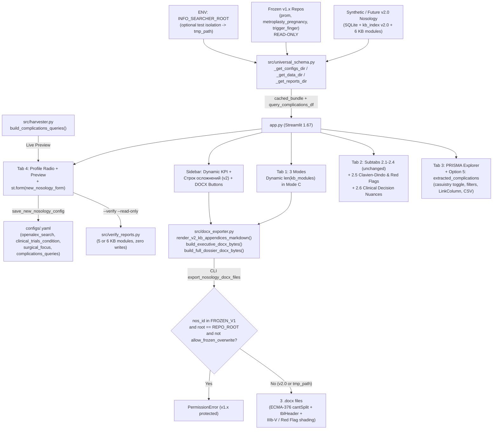

# Phase 19: Визуализация осложнений и клинических нюансов в `app.py`, экспорт `.docx` и автотесты `v2.0` - Research

**Researched:** 2026-11-22
**Domain:** Streamlit `1.67` + Plotly `7.1` Clinical Visualization & `AppTest`, Pure-Python ECMA-376 OpenXML `.docx` Table Styling & `v2.0` Appendices, Isolated E2E Testing & Frozen `v1.x` Backward Compatibility
**Confidence:** HIGH

<user_constraints>
## User Constraints (from 19-CONTEXT.md)

### Locked Decisions

#### Вкладка 2 (`app.py`): подвкладки `2.5 Осложнения (Clavien–Dindo)` и `2.6 Клинические компромиссы и серые зоны`
- **D-01:** Во вкладке 2 (`render_tab_clinical_matrix`) добавляются **две отдельные подвкладки** к существующим `2.1–2.4`:
  - `2.5 «⚠️ Осложнения (Clavien–Dindo)»`
  - `2.6 «🧭 Клинические компромиссы и серые зоны»`
  Существующие подвкладки `2.1–2.4` не перегружаются. Дополнительно: подпись Режима В во вкладке 1 показывает динамическое число модулей `len(kb_modules)` (в `v2.0` их 6, включая `06_complications_and_safety.md`), а в сайдбаре выводится метрика `Строк осложнений` при `extracted_complications_rows > 0` или `schema_version == "2.0"`.
- **D-02:** Подвкладка `2.5` для нозологий `v2.0` включает:
  1. Интерактивные фильтры: методики (`multiselect`), тяжесть `clavien_dindo_grade` (`I`, `II`, `IIIa`, `IIIb`, `IV`, `V`), обратимость (`reversibility`) и класс события (`event_class`: `true_complication` vs `transient_postop_sequela`).
  2. Два интерактивных графика Plotly: (а) горизонтальный bar chart медианных частот (`frequency_median_num`, `%`) с цветовой кодировкой по `Clavien–Dindo` (и переключением цвета на `reversibility`) и подробным hover (`frequency_pct`, `time_window`, `sample_size_total`, `evidence_pmids`); (б) stacked bar chart распределения осложнений по классам `Clavien–Dindo` (`I–V`) в разрезе лечебных методик.
  3. Отфильтрованную таблицу `frequent_complications` (методика, осложнение, класс события, `Clavien–Dindo`, частота `%`, обратимость, окно разрешения `time_window`, анатомический субстрат, профилактика и лечение, выборка `N`, `PMID`) с кнопкой экспорта `.csv`.
  4. Отдельный визуально выделенный блок **«Красные флаги: редкие критические осложнения (<1%)»** (`rare_critical_red_flags`).
  5. **Fallback для замороженных нозологий `v1.x`:** при отсутствии/пустоте `frequent_complications` выводится мягкий информационный баннер `v1.x` и сводная таблица текстовых полей `complications_profile` из `modalities` (без ошибок и без записи на диск).
- **D-03:** Подвкладка `2.6` для нозологий `v2.0` визуализирует `clinical_decision_nuances` тремя блоками:
  1. **Сквозные методики («рабочие лошадки»)** (`universal_workhorse_modalities`): покрываемый спектр стадий (`applicable_spectrum`), практические нюансы (`practical_nuances`), факторы опыта хирурга и оснащения (`surgeon_and_equipment_factors`), компромиссы для пациента (`patient_tradeoffs`), `evidence_pmids`.
  2. **Перекрывающиеся показания и «серые зоны»** (`overlapping_indications_and_gray_zones`): клинический сценарий (`clinical_scenario`), конкурирующие методики (`competing_modalities`), почему нет одного «победителя» (`why_no_single_winner`), решающие практические факторы (`decisive_practical_factors`), `evidence_pmids`.
  3. **Узконишевые показания и методики спасения** (`strict_niche_or_salvage_indications`, отображается при наличии записей): роль (`narrow_indication_or_salvage_role`), почему не первая линия (`why_not_first_line_for_all`), `evidence_pmids`.
  4. **Fallback для `v1.x`:** информационный баннер `v1.x` со ссылкой на подвкладку `2.4` («Бок-о-бок сравнение методик»).

#### Вкладки 3 и 4 (`app.py`): навигатор `extracted_complications`, форма `surgical_focus` и read-only аудит
- **D-04:** Вкладка 3 (`render_tab_prisma_explorer`) получает **5-ю опцию** радио-переключателя: `5. Извлечённые осложнения лечения (extracted_complications)` через кэшированную функцию `universal_schema.query_complications_df(db_path, include_casuistry=...)`. Внутри:
  - фильтры по методике (`modality`), `clavien_dindo_grade`, обратимости (`reversibility`), классу события (`event_class`);
  - чекбокс «Показать редкую казуистику (`Tier 4 / N<20`)»;
  - текстовый поиск по названию осложнения, анатомическому субстрату и профилактике/лечению;
  - кликабельные столбцы `PubMed` / `DOI` (`LinkColumn`) и кнопка скачивания `.csv` (`utf-8-sig`).
  На базах `v1.x` без таблицы `extracted_complications` отображается спокойное информационное сообщение (0 записей) в строго read-only режиме.
- **D-05:** Вкладка 4 (`render_tab_configurator_and_audit`):
  1. В форме создания новой нозологии (`new_nosology_form`) добавляется переключатель клинического профиля: **«Хирургическая / смешанная (`surgical_focus: true`)»** vs **«Чисто консервативная (`surgical_focus: false`, `treatment_profile: conservative`)»**.
  2. На основе введённых терминов и выбранного профиля показывается **живой предпросмотр автогенерируемого запроса осложнений** (через `harvester.build_complications_queries()`), плюс два необязательных текстовых поля для ручного переопределения `complications_queries.pubmed` и `complications_queries.europepmc`.
  3. Выравниваются ключи сохраняемого YAML в `save_new_nosology_config()`: `queries.openalex_search` и `queries.clinical_trials_condition` (в соответствии с `src/harvester.py` вместо старых `openalex` / `clinicaltrials`).
  4. Кнопка перезапуска аудита (`verify_reports.py`) запускает проверку строго с флагом **`--read-only`** (`--nosology <id> --verify --read-only`), предотвращая случайную перезапись `verification_audit.md` у замороженных нозологий `v1.x`.

#### Экспорт MS Word (`src/docx_exporter.py`)
- **D-06:** В `src/docx_exporter.py` добавляется единый публичный генератор структурированных Markdown-приложений `render_v2_kb_appendices_markdown(kb_index)` (и вспомогательные функции сборки секций `build_executive_docx_bytes(exec_md, kb_index)` / `build_full_dossier_docx_bytes(exec_md, diss_md, kb_modules_md, kb_index)`), который для нозологий `v2.0` (при `schema_version == "2.0"` или непустых `frequent_complications` / `clinical_decision_nuances`) формирует:
  - структурированную таблицу частых осложнений (`Clavien–Dindo`, медиана и диапазон `%`, класс события, обратимость и сроки, анатомический субстрат, профилактика и лечение, `PMID`) + отдельный подблок `rare_critical_red_flags`;
  - структурированную матрицу `clinical_decision_nuances` (сквозные методики, перекрывающиеся показания и «серые зоны», узконишевые/спасательные методики с `PMID`).
  Эти приложения автоматически добавляются в конец **`full_clinical_dossier.docx`** и **`executive_summary.docx`** — единым кодом как в CLI (`export_nosology_docx_files()`), так и в кнопках скачивания `app.py`. Файл **`dissertation_report.docx`** остаётся чистым рендером `dissertation_report.md` без дублирования глав. Для нозологий `v1.x` вывод всех трёх `.docx` остаётся `100%` идентичным `v1.x`.
- **D-07:** Улучшение OpenXML-вёрстки таблиц в `src/docx_exporter.py` и защита `v1.x`:
  1. Строке заголовка каждой таблицы добавляется `<w:tblHeader/>` (автоповтор шапки при переносе на новую страницу), каждой строке — `<w:cantSplit/>` (запрет разрыва строки пополам).
  2. Для ячеек/строк с критической тяжестью `Clavien–Dindo IIIb / IV / V` и подблока «Красных флагов» применяется мягкая академическая заливка (`<w:shd w:fill="..."/>` — пастельно-красный/янтарный фон с контрастным тёмным текстом).
  3. В `export_nosology_docx_files()` (при записи в корневой `reports/<id>` проекта) добавляется защита замороженных нозологий `v1.x` (`prom`, `metroplasty_pregnancy`, `trigger_finger`): перезапись блокируется без явного `allow_frozen_overwrite=True` / CLI-флага `--allow-frozen-overwrite` (in-memory генерация в `app.py` и экспорт во временный `base_dir` в тестах работают без ограничений).

#### Автотесты `v2.0` и самотестирование (`tests/test_v2_engine.py` + `app.py --self-test`)
- **D-08:** Финальный тестовый контур Фазы 19 включает:
  1. **`tests/test_v2_engine.py` (E2E `v2.0`):** временная синтетическая нозология `v2.0` (`tmp_path`), проходящая полный цикл: конфиг с `surgical_focus: true` -> `harvester.build_complications_queries()` -> SQLite (`articles`, `extracted_complications`, `extracted_clinical_evidence`, `extracted_mechanisms`, `clinical_trials`) -> `aggregate_complications_from_sqlite()` -> `kb_index.json v2.0` + `dissertation_report.md` + `executive_summary.md` + 6 модулей БЗ -> `verify_reports` (`--schema-version v2 --read-only`) -> `docx_exporter` с разбором `word/document.xml` (проверка `<w:tblHeader/>`, `<w:cantSplit/>`, подсветки `IIIb–V`, наличия таблиц осложнений и `clinical_decision_nuances`) -> `Streamlit AppTest` с рендерингом вкладок 1–4, включая подвкладки `2.5` и `2.6`, таблицу `extracted_complications` во вкладке 3 и форму `surgical_focus` во вкладке 4.
  2. **`tests/test_v2_engine.py` (Регрессия и неизменность `v1.x`):** прогон всех 3 замороженных нозологий (`prom`, `metroplasty_pregnancy`, `trigger_finger`) через `load_nosology_bundle`, `query_complications_df`, `verify_universal_schema`, in-memory `docx_exporter`, защиту `export_nosology_docx_files` от перезаписи `v1.x` и `Streamlit AppTest` с проверкой контрольного снимка файлов (sha256/mtime) до и после тестов.
  3. **Расширенный `uv run app.py --self-test`:** проверяет рендеринг новых подвкладок `2.5` и `2.6`, 5-ю таблицу `extracted_complications` во вкладке 3 и `0` исключений `AppTest` на всех обнаруженных нозологиях.

### the agent's Discretion
- Точная цветовая палитра Plotly для классов `Clavien–Dindo` (`I` -> зелёный/бирюзовый, `II` -> синий, `IIIa` -> янтарный, `IIIb` -> оранжевый, `IV` -> красный, `V` -> тёмно-бордовый) и пастельных заливок OpenXML `<w:shd>` в `src/docx_exporter.py`.
- Точные русские подписи (display labels) для enum-значений `reversibility` (`transient_self_limiting`, `requires_conservative_therapy`, `requires_reoperation`, `permanent_deficit`) и `event_class` (`true_complication`, `transient_postop_sequela`) в фильтрах, таблицах `app.py` и `.docx`.
- Чистка устаревшего параметра Streamlit `use_container_width=True` -> `width="stretch"` (если поддерживается текущей версией Streamlit в `uv`-окружении без ломки `AppTest`) для устранения предупреждений в консоли.
- Имена вспомогательных функций внутри `app.py` и `src/docx_exporter.py` при условии сохранения обратной совместимости публичных сигнатур `build_docx_bytes_from_markdown`, `build_docx_bytes_from_markdown_sections`, `export_nosology_docx_files`.

### Deferred Ideas (OUT OF SCOPE)
None — discussion stayed within phase scope.
</user_constraints>

<phase_requirements>
## Phase Requirements

| ID | Description | Research Support |
|----|-------------|------------------|
| **UI-02** | Веб-интерфейс `app.py` отображает интерактивный профиль частых осложнений (`Clavien–Dindo`, частота по методикам, обратимость vs стойкий дефицит, тактика коррекции), таблицу `extracted_complications` в PRISMA-навигаторе с выгрузкой в `.csv`, блок клинических нюансов/перекрывающихся показаний (`clinical_decision_nuances`), а также переключатель `surgical_focus` и живой предпросмотр запросов осложнений во вкладке 4, не ломая рендеринг готовых нозологий `v1.x`. | См. `Architecture Patterns` → Pattern 1 (`INFO_SEARCHER_ROOT` + cache keying), Pattern 2 (подвкладки `2.5` и `2.6`, Plotly `7.1`, `width="stretch"` в Streamlit `1.67`, нативные карточки без `unsafe_allow_html`), Pattern 3 (5-я опция вкладки 3 `extracted_complications`), Pattern 4 (реактивный блок предпросмотра `harvester.build_complications_queries()` над `st.form("new_nosology_form")` + `--read-only` аудит). |
| **EXPORT-02** | Экспортер `src/docx_exporter.py` и набор автотестов (`tests/test_v2_engine.py` + `uv run app.py --self-test`) проверяют полный цикл работы движка `v2.0` (таблица осложнений с `<w:tblHeader/>` / `<w:cantSplit/>` / подсветкой `IIIb–V`, блок `clinical_decision_nuances`, линтер де-ИИзации выводов, генерация `.docx`, защита `v1.x` от перезаписи и обратная совместимость с `prom`, `metroplasty_pregnancy`, `trigger_finger`). | См. `Architecture Patterns` → Pattern 5 (`render_v2_kb_appendices_markdown`, `build_executive_docx_bytes`, `build_full_dossier_docx_bytes`, строгое упорядочивание ECMA-376 `CT_TrPrBase`/`CT_TcPrInner`, защита `FROZEN_V1_NOSOLOGIES`), Pattern 6 (исправление жесткого `== 5` / `== 7` в `src/verify_reports.py` под 6 модулей `v2.0`) и `Validation Architecture`. |
</phase_requirements>

---

## Summary

Фаза 19 завершает Milestone `v2.0`, связывая созданное в Фазах 17–18 ядро (`extracted_complications`, `frequent_complications`, `rare_critical_red_flags`, `clinical_decision_nuances`, `harvester.build_complications_queries`, `verify_reports --read-only`) с тремя пользовательскими и верификационными слоями: веб-приложением `app.py`, генератором MS Word `src/docx_exporter.py` и сквозным комплектом автотестов `tests/test_v2_engine.py` + `app.py --self-test` `[VERIFIED: codebase]`. Вся реализация опирается на уже установленный стек `uv` (`Python 3.12.16`, `Streamlit 1.67.0`, `Plotly 7.1.0`, `pandas 3.1.1`, `PyYAML 6.0.4`, `markdown 3.11.3`, `pytest 9.2.0`) без добавления новых сторонних зависимостей `[VERIFIED: uv runtime probe]`.

Глубокая инспекция кодовой базы выявила **четыре критических технических нюанса**, знание которых предотвратит регрессии и сбои при планировании и исполнении:
1. **Жесткие проверки количества модулей в `src/verify_reports.py:830,843`:** сейчас стоят `assert len(kb_data.get("modules", [])) == 5` и `assert len(report_files) == 7`. Для `v2.0`-нозологий с 6 модулями БЗ (включая `06_complications_and_safety.md`, как зафиксировано в **D-01** и **D-08**) этот `assert` упадёт; требуется ослабить проверку до `>= 5` при точном совпадении `len(kb_md_files) == len(kb_data.get("modules", []))`, сохраняя 100% совместимость с 5-модульными тестами Фазы 18 и архивами `v1.x` `[VERIFIED: src/verify_reports.py:830-844]`.
2. **Отсутствие `truststore` в PEP 723 заголовке `app.py`:** модуль `src/harvester.py:32-33` импортирует `truststore` на верхнем уровне, тогда как `app.py:3-9` его не декларирует. При импорте `harvester.build_complications_queries` во вкладке 4 запуск `uv run app.py --self-test` упадёт с `ModuleNotFoundError`, если не добавить `"truststore>=0.10.0"` в PEP 723 `# dependencies` файла `app.py` (а также обновить `"streamlit>=1.50.0"` под `width="stretch"`) `[VERIFIED: app.py:1-10, src/harvester.py:32-33]`.
3. **Изоляция `AppTest` на `tmp_path` + кэширование Streamlit:** в `src/universal_schema.py:181` `discover_nosologies(configs_dir: Path = CONFIGS_DIR)` связывает `CONFIGS_DIR` на момент импорта модуля, а `app.py:57` кэширует `cached_bundle(nosology_id)` через `@st.cache_data`. Введение динамического чтения `os.environ.get("INFO_SEARCHER_ROOT")` (с сохранением приоритета `monkeypatch.setattr(universal_schema, "CONFIGS_DIR", ...)` когда переменная среды не задана) + передача `workspace_root` в ключ `cached_bundle()` позволяет безопасно тестировать синтетическую нозологию `v2.0` в `tmp_path` через `AppTest.from_file("app.py")` с нулевым риском мутации реальных папок `configs/`, `data/` и `reports/` `[VERIFIED: src/universal_schema.py:33-51,181-205, app.py:57-59]`.
4. **Реактивный предпросмотр и форма `st.form` во вкладке 4 + безопасный дефолт ID:** виджеты внутри `st.form` не перерисовывают приложение до нажатия submit, а в `AppTest` вызов `.run()` между редактированием поля формы и кликом `form_submit_button` сбрасывает незафиксированный ввод `[VERIFIED: Streamlit 1.67 AppTest probe]`. Переключатель профиля `surgical_focus`, поля `MeSH` / `core_terms` и живой предпросмотр `build_complications_queries()` следует разместить **над** `st.form("new_nosology_form")`, а дефолтное значение `new_id` заменить с опасного `"trigger_finger"` (замороженная нозология `v1.x`!) на безопасный пример `"carpal_tunnel_syndrome"` `[VERIFIED: app.py:955-969]`.

**Primary recommendation:** Разбить Phase 19 на 3 чётких плана в 2 волнах:
- **Wave 1 (параллельно):**
  - **Plan 19-01 (`src/docx_exporter.py` + `src/universal_schema.py` + `src/verify_reports.py`):** OpenXML-апгрейд (`<w:cantSplit/>` перед `<w:tblHeader/>`, подсветка `IIIb–V` и «Красных флагов» без ложных срабатываний на стадиях `IV`), `render_v2_kb_appendices_markdown()`, `build_executive_docx_bytes()`, `build_full_dossier_docx_bytes()`, защита `FROZEN_V1_NOSOLOGIES` + `--allow-frozen-overwrite`, `INFO_SEARCHER_ROOT` в `universal_schema.py` / `verify_reports.py` и поддержка `>= 5` (5–6) модулей БЗ в `verify_reports.py`.
  - **Plan 19-02 (`app.py`):** подвкладки `2.5` (фильтры, 2 графика Plotly, таблица, CSV, блок Red Flags, `v1.x` fallback) и `2.6` (`clinical_decision_nuances`, `v1.x` fallback), 5-я таблица `extracted_complications` во вкладке 3, реактивный предпросмотр `surgical_focus` + `st.form` с выровненными YAML-ключами + `--read-only` аудит во вкладке 4, динамический счётчик модулей в Режиме В, метрика `Строк осложнений` в сайдбаре, переключение кнопок `.docx` на единые `v2.0`-генераторы, миграция `use_container_width=True` -> `width="stretch"`, расширенный `run_self_test()`.
- **Wave 2 (после Wave 1):**
  - **Plan 19-03 (`tests/test_v2_engine.py` + сквозной прогон):** полный E2E-тест синтетической `v2.0`-нозологии (6 модулей БЗ, SQLite -> `aggregate_complications_from_sqlite` -> `verify_reports --schema-version v2 --read-only` -> `docx_exporter` + XML-аудит -> `Streamlit AppTest` по всем 4 вкладкам и форме `surgical_focus`), полный регрессионный и sha256/mtime-тест замороженных `v1.x` (`prom`, `metroplasty_pregnancy`, `trigger_finger`), проверка `uv run app.py --self-test` и `git status`.

---

## Architectural Responsibility Map

| Capability | Primary Tier | Secondary Tier | Rationale |
|------------|-------------|----------------|-----------|
| Интерактивная визуализация `frequent_complications` (`Clavien–Dindo`, Plotly bar + stacked bar), `rare_critical_red_flags` и `clinical_decision_nuances` (`D-01..D-03`) | **Presentation / Streamlit UI** (`app.py`) | **Universal Schema Adapter** (`src/universal_schema.py`) | `app.py` отвечает за фильтрацию в памяти, Plotly-рендеринг и безопасный `v1.x` fallback, не обращаясь напрямую к SQLite и не мутируя файлы. |
| Навигатор `extracted_complications` с фильтрами, казуистикой `Tier 4`, `LinkColumn` и `.csv` (`D-04`) | **Presentation / Streamlit UI** (`app.py`) | **Database / Read-Only Query Layer** (`src/universal_schema.py:query_complications_df`) | Вся SQLite-логика и read-only URI защита (`sqlite_master` + `PRAGMA query_only=ON`) уже инкапсулированы в `universal_schema.py`; `app.py` оборачивает вызов в `@st.cache_data`. |
| Конфигуратор новой нозологии (`surgical_focus`, предпросмотр запросов осложнений, сохранение YAML) и read-only аудит (`D-05`) | **Presentation / Streamlit UI** (`app.py`) | **Harvester Query Builder** (`src/harvester.py:build_complications_queries`) + **Schema Persistence** (`src/universal_schema.py:save_new_nosology_config`) + **Verifier CLI** (`src/verify_reports.py --read-only`) | Единый источник истины для автогенерируемых запросов — `harvester.py`; нормализация и path-traversal защита YAML — `universal_schema.py`. |
| Компиляция `.docx` с приложениями `v2.0`, `<w:tblHeader/>`/`<w:cantSplit/>`, подсветкой `IIIb–V` и защитой `v1.x` (`D-06`, `D-07`) | **Document Export Engine** (`src/docx_exporter.py`) | **Presentation / Streamlit UI** (`app.py` download buttons) + **Verifier CLI** (`src/verify_reports.py`) | Единые публичные функции `build_executive_docx_bytes` и `build_full_dossier_docx_bytes` гарантируют побайтовую идентичность экспорта из CLI и веб-интерфейса. |
| Изолированное E2E-тестирование `v2.0` и неизменность замороженных `v1.x` (`D-08`) | **Verification & Test Suite** (`tests/test_v2_engine.py`, `app.py --self-test`) | **Workspace Root Resolver** (`INFO_SEARCHER_ROOT` в `src/universal_schema.py` / `src/verify_reports.py`) | Изоляция через `tmp_path` + `INFO_SEARCHER_ROOT` позволяет запускать реальный `Streamlit AppTest` над синтетической `v2.0`-нозологией без записи в корневой репозиторий. |

---

## Standard Stack

Фаза 19 **не вводит ни одного нового внешнего пакета** поверх уже используемого в репозитории стека `uv` `[VERIFIED: uv runtime probe]`. В `app.py` (PEP 723 `# dependencies`) требуется лишь зафиксировать уже используемый в `src/harvester.py` пакет `truststore>=0.10.0` и поднять нижнюю границу `streamlit>=1.50.0` (под параметр `width="stretch"`).

### Core

| Library | Verified Version (`uv`) | Purpose | Why Standard |
|---------|-------------------------|---------|--------------|
| `Python` | `3.12.16` `[VERIFIED: uv runtime]` | Среда выполнения всех скриптов и тестов | Единая версия Python в `uv`-окружении проекта. |
| `streamlit` | `1.67.0` `[VERIFIED: uv runtime]` | Веб-витрина `app.py`, `st.tabs`, `st.dataframe`, `st.column_config.LinkColumn`, `st.download_button`, `streamlit.testing.v1.AppTest` | Текущий UI-фреймворк проекта; `1.67.0` полностью поддерживает `width="stretch"` (без deprecation-логов) и `AppTest` для вложенных вкладок и форм. |
| `plotly` | `7.1.0` `[VERIFIED: uv runtime]` | Интерактивные графики `px.bar` / `go.Figure` (горизонтальный bar chart частот + stacked bar chart `Clavien–Dindo`) | Уже используется во вкладках 2 и 3 `app.py`; нативный hover, сортировка категорий и цветовые карты. |
| `pandas` | `3.1.1` `[VERIFIED: uv runtime]` | Фильтрация `frequent_complications` и `extracted_complications`, группировка для stacked bar chart, `.csv` (`utf-8-sig`) | Стандартный табличный слой в `universal_schema.py` и `app.py`. |
| `xml.etree.ElementTree` + `zipfile` (stdlib) | Python `3.12` stdlib `[VERIFIED: uv runtime]` | Чистый OpenXML-генератор `.docx` и валидация `word/document.xml` в `src/docx_exporter.py` и тестах | Нулевые бинарные зависимости, строгий контроль каждого XML-тега `<w:trPr>` / `<w:tcPr>` / `<w:shd>`. |
| `PyYAML` | `6.0.4` `[VERIFIED: uv runtime]` | Сохранение и чтение `configs/<id>.yaml` (`surgical_focus`, `treatment_profile`, `complications_queries`) | Штатный YAML-парсер проекта (`yaml.safe_load` / `yaml.safe_dump`). |
| `truststore` | `0.10.5` `[VERIFIED: uv runtime]` | Системное TLS-хранилище Windows, импортируемое на верхнем уровне `src/harvester.py` | Уже используется в `src/harvester.py` и `src/triage.py`; добавление в PEP 723 `app.py` необходимо для `uv run app.py --self-test`. |

### Supporting (Testing)

| Library | Verified Version (`uv`) | Purpose | When to Use |
|---------|-------------------------|---------|-------------|
| `pytest` | `9.2.0` `[VERIFIED: uv runtime]` | Запуск `tests/test_phase17_complications.py`, `tests/test_phase18_humanizer.py`, `tests/test_v2_engine.py` | Через `uv run --with pytest --with streamlit --with plotly ... pytest tests/ -v`. |
| `markdown` | `3.11.3` `[VERIFIED: uv runtime]` | Зависимость `src/universal_schema.py:render_printable_html` | При импорте `universal_schema` и в `app.py`. |

### Alternatives Considered

| Instead of | Could Use | Tradeoff |
|------------|-----------|----------|
| `width="stretch"` (Streamlit `1.67.0`) | Оставить `use_container_width=True` | `use_container_width=True` в `Streamlit 1.67.0` печатает ~40 строк deprecation-предупреждений (`will be removed after 2025-12-31`) при каждом прогоне `app.py --self-test` `[VERIFIED: live self-test run]`. `width="stretch"` даёт 0 предупреждений и чистый вывод. |
| Реактивный блок `surgical_focus` + `MeSH`/`core_terms` + предпросмотр **над** `st.form` | Всё внутри `st.form("new_nosology_form")` | Виджеты внутри `st.form` не запускают rerun при изменении, поэтому «живой предпросмотр» запроса при переключении `surgical_focus` невозможен внутри `st.form` `[VERIFIED: Streamlit 1.67 AppTest probe]`. |
| `INFO_SEARCHER_ROOT` env var + явный аргумент `workspace_root` в `cached_bundle` | Только `monkeypatch.setattr` на `universal_schema.CONFIGS_DIR` | `AppTest.from_file("app.py")` и дочерний `subprocess.run(verify_reports.py)` не наследуют in-memory `monkeypatch` в дочернем процессе и ломаются на default-аргументе `configs_dir=CONFIGS_DIR`. `INFO_SEARCHER_ROOT` работает сквозь оба контура и сохраняет совместимость с `monkeypatch`. |
| Нативные Streamlit-компоненты (`st.error`, `st.container(border=True)`, `st.markdown`) для Red Flags и `2.6` | Кастомный HTML с `unsafe_allow_html=True` | Кастомный HTML из JSON-полей KB создаёт поверхность XSS/HTML-инъекций и ломает символы `< 0.5%`; нативные контейнеры визуально чисты и полностью безопасны (ASVS V5). |

### Package Legitimacy Audit
Новые внешние пакеты в Фазе 19 **не устанавливаются** (`0` новых пакетов). Все пакеты (`streamlit`, `plotly`, `pandas`, `pyyaml`, `markdown`, `truststore`, `pytest`) уже используются в репозитории и подтверждены в локальном `uv`-окружении `[VERIFIED: uv runtime probe]`.

---

## Architecture Patterns

### System Architecture Diagram



### Pattern 1: Isolated Workspace Root (`INFO_SEARCHER_ROOT`) + Cache Keying
**What:** Динамическое разрешение директорий `configs/`, `data/`, `reports/` через переменную среды `INFO_SEARCHER_ROOT` (если задана) с полным сохранением обратной совместимости с `monkeypatch.setattr(universal_schema, "CONFIGS_DIR", ...)` в существующих тестах Фаз 17–18.
**When to use:** Всегда при загрузке/обнаружении/сохранении нозологий в `src/universal_schema.py`, при поиске путей в `src/verify_reports.py` и при вызове `cached_bundle()` в `app.py`.
**Key details:**
1. В `src/universal_schema.py`:
   - Добавить функции `_get_configs_dir()`, `_get_data_dir()`, `_get_reports_dir()` и `get_workspace_root() -> Path`:
     - Если `os.environ.get("INFO_SEARCHER_ROOT", "").strip()` задан -> возвращать `Path(env_root).resolve() / "<subdir>"`.
     - Иначе -> возвращать модульные константы `CONFIGS_DIR`, `DATA_DIR`, `REPORTS_DIR` (сохраняя работоспособность всех `monkeypatch.setattr` в `tests/test_phase17_complications.py` и `tests/test_phase18_humanizer.py`!).
   - Изменить сигнатуру `discover_nosologies(configs_dir: Path | None = None)` — убрать связывание `CONFIGS_DIR` на этапе определения функции! Внутри использовать `target_configs = configs_dir if configs_dir is not None else _get_configs_dir()`, `data_root = _get_data_dir().resolve()`, `reports_root = _get_reports_dir().resolve()`.
   - В `load_nosology_bundle()` и `save_new_nosology_config()` заменить прямые ссылки на `CONFIGS_DIR`/`DATA_DIR`/`REPORTS_DIR` вызовами `_get_configs_dir()` / `_get_data_dir()` / `_get_reports_dir()`.
2. В `src/verify_reports.py`:
   - В `get_nosology_paths(nosology_id, *, base_dir=None)`: при `base_dir is None` проверять `env_root = os.environ.get("INFO_SEARCHER_ROOT", "").strip()`, и если задан, использовать `Path(env_root).resolve()` вместо `PROJECT_ROOT`.
3. В `app.py`:
   - В `cached_bundle(nosology_id: str, workspace_root: str = "")`: передавать `workspace_root=str(get_workspace_root())` (или `os.environ.get("INFO_SEARCHER_ROOT", "")`), чтобы кэш `@st.cache_data` в рамках одного процесса `pytest` никогда не смешивал реальный корень репозитория и `tmp_path`!

### Pattern 2: Tab 2 Subtabs `2.5` & `2.6` — Plotly Visuals, Safe Cards & `v1.x` Fallback (`D-01..D-03`)
**What:** Две модульные функции `_render_subtab_complications(kb, nos_id)` и `_render_subtab_clinical_nuances(kb)`, подключаемые как 5-я и 6-я вкладки в `st.tabs([...])` внутри `render_tab_clinical_matrix()`.
**When to use:** Всегда в Tab 2; автоматически переключаются между `v2.0`-витриной и мягким `v1.x`-fallback.
**Exact design details:**
- **Русские подписи и цветовые константы (единые для UI и справочно-согласованные с `.docx`):**
  - `CLAVIEN_DINDO_ORDER = ["I", "II", "IIIa", "IIIb", "IV", "V"]`
  - `CLAVIEN_DINDO_COLORS = {"I": "#10b981", "II": "#3b82f6", "IIIa": "#f59e0b", "IIIb": "#f97316", "IV": "#ef4444", "V": "#7f1d1d"}`
  - `REVERSIBILITY_LABELS_RU`:
    - `"transient_self_limiting"` -> `"Транзиторное (самокупирующееся)"`
    - `"requires_conservative_therapy"` -> `"Требует консервативной терапии"`
    - `"requires_reoperation"` -> `"Требует повторной операции / ревизии"`
    - `"permanent_deficit"` -> `"Стойкий дефицит"`
  - `REVERSIBILITY_COLORS = {"transient_self_limiting": "#10b981", "requires_conservative_therapy": "#3b82f6", "requires_reoperation": "#f97316", "permanent_deficit": "#b91c1c"}`
  - `EVENT_CLASS_LABELS_RU`:
    - `"true_complication"` -> `"Истинное осложнение"`
    - `"transient_postop_sequela"` -> `"Транзиторное послеоперационное явление"`
- **Подвкладка `2.5` (`⚠️ 2.5. Осложнения (Clavien–Dindo)`):**
  - Если `frequent_complications` пуст (`v1.x` fallback): вывести `st.info(...)` с пояснением о схеме `v1.x` и сводную таблицу из `kb.get("modalities", [])` с колонками `Класс`, `Методика лечения`, `Профиль осложнений (v1.x)`, `Реабилитация` (`width="stretch"`, `hide_index=True`).
  - Если `frequent_complications` непуст (`v2.0`):
    1. 4 фильтра в `st.columns(4)`: методики (`key="t25_modalities"`), классы `Clavien–Dindo` (`key="t25_grades"`), обратимость (`key="t25_reversibility"` с `format_func`), класс события (`key="t25_event_class"` с `format_func`).
    2. Если после фильтрации `df_view.empty`: вывести `st.warning("Нет осложнений, соответствующих выбранным фильтрам.")` и не строить пустые Plotly-графики.
    3. Радио-переключатель цвета для графика (а): `st.radio("Цветовая кодировка диаграммы частот:", ["Класс Clavien–Dindo", "Обратимость"], horizontal=True, key="t25_color_mode")`.
    4. **График (а) — горизонтальный bar chart медианных частот (`frequency_median_num`, `%`):**
       - Сортировка `df_view.sort_values("frequency_median_num", ascending=False)` с уникальной подписью оси Y `display_label = f"{complication_name} — {modality}"` (чтобы одинаковое осложнение у разных методик не склеивалось в один столбец!).
       - `px.bar(..., x="frequency_median_num", y="display_label", color=color_col, orientation="h", text="frequency_pct", color_discrete_map=..., category_orders=..., hover_data={...})`.
       - В `hover_data` обязательно включить `frequency_pct`, `time_window`, `sample_size_total`, `evidence_pmids_str`, `modality`, `event_class_ru`, `reversibility_ru`, `clavien_dindo_grade`.
       - `fig_freq.update_layout(yaxis=dict(autorange="reversed"), height=max(360, 48 * len(df_view) + 120))`.
    5. **График (б) — stacked bar chart распределения по классам `Clavien–Dindo` (`I–V`) в разрезе методик:**
       - `df_stack = df_view.groupby(["modality", "clavien_dindo_grade"], as_index=False).size().rename(columns={"size": "Количество событий"})`
       - `px.bar(df_stack, x="modality", y="Количество событий", color="clavien_dindo_grade", barmode="stack", color_discrete_map=CLAVIEN_DINDO_COLORS, category_orders={"clavien_dindo_grade": CLAVIEN_DINDO_ORDER}, text_auto=True)`.
    6. Отфильтрованная таблица `frequent_complications` (все 11 колонок по **D-02.3**) + кнопка `st.download_button(..., data=dataframe_to_csv_bytes(disp_fc), file_name=f"{nos_id}_frequent_complications.csv", key="dl_csv_freq_comp")`.
    7. Выделенный блок **«🚨 Красные флаги: редкие критические осложнения (<1%)»** (`rare_critical_red_flags`):
       - `st.error(...)` заголовок-предупреждение + карточки в `st.container(border=True)` (или сводная таблица + карточки) с выводом `modality`, `complication_name`, `clavien_dindo_grade`, `frequency_pct`, `reversibility_ru`, `anatomical_substrate`, `prevention_and_management` и валидированными ссылками `PMID`.
- **Подвкладка `2.6` (`🧭 2.6. Клинические компромиссы и серые зоны`):**
  - Проверяет 3 списка из `kb.get("clinical_decision_nuances") or {}`.
  - Если все 3 пусты (`v1.x` fallback): `st.info(...)` со ссылкой на подвкладку `2.4` («Бок-о-бок сравнение методик + Доказательства SQLite»).
  - Если непусты (`v2.0`):
    - Блок 1: **Сквозные методики («рабочие лошадки»)** (`universal_workhorse_modalities`) — карточки `st.container(border=True)` с 2 колонками (`applicable_spectrum` / `practical_nuances` vs `surgeon_and_equipment_factors` / `patient_tradeoffs`) и строкой кликабельных `PMID`.
    - Блок 2: **Перекрывающиеся показания и «серые зоны»** (`overlapping_indications_and_gray_zones`) — карточки с перечислением `competing_modalities`, акцентом `st.warning` на `why_no_single_winner`, блоком `decisive_practical_factors` и `PMID`.
    - Блок 3 (отображается только если `len(niches) > 0`): **Узконишевые показания и методики спасения** (`strict_niche_or_salvage_indications`) — карточки с `modality`, `narrow_indication_or_salvage_role`, `why_not_first_line_for_all` и `PMID`.

### Pattern 3: Tab 3 — 5th Radio Option `extracted_complications` (`D-04`)
**What:** Расширение `render_tab_prisma_explorer()` 5-й опцией радио-переключателя через кэшированный вызов `cached_complications(db_path_str, include_casuistry=...)`.
**When to use:** Вкладка 3 для всех нозологий (`v1.x` и `v2.0`).
**Key details:**
- Заменить `else:` у 4-й опции (`app.py:883`) на `elif table_choice.startswith("4."):` и добавить ветку `else:` для 5-й опции (`f"5. Извлечённые осложнения лечения ({len(df_comp_all)})"`).
- Если `df_comp_all.empty`: вывести `st.info(...)` («0 записей, read-only режим — таблица `extracted_complications` отсутствует в базе `v1.x` или пуста») без падений и без создания таблицы.
- Если непусто:
  - Чекбокс `show_casuistry = st.checkbox("Показать редкую казуистику (Tier 4 / N<20)", value=False, key="t3_comp_casuistry")` -> подгружает `df_comp = cached_complications(db_path_str, include_casuistry=show_casuistry)`.
  - 4 фильтра (`modality`, `clavien_dindo_grade`, `reversibility`, `event_class`) + текстовый поиск `kw_comp` (`regex=False`) по `complication_name`, `anatomical_substrate`, `prevention_and_management`, `modality`, `pmid`.
  - Отображение в `st.dataframe(..., width="stretch", hide_index=True, column_config={"pubmed_url": st.column_config.LinkColumn("PubMed", display_text="Открыть PubMed"), "doi_url": st.column_config.LinkColumn("DOI", display_text="Открыть DOI")})`.
  - Экспорт `st.download_button("📥 Скачать извлечённые осложнения (.csv)", data=dataframe_to_csv_bytes(view_disp), file_name=f"{nos_id}_extracted_complications.csv", mime="text/csv", key="dl_csv_comp")`.

### Pattern 4: Tab 4 — Two-Part Reactive Preview + `st.form` Save + `--read-only` Audit (`D-05`)
**What:** Разделение конфигуратора на (1) реактивный блок выбора профиля `surgical_focus` + терминов `MeSH`/`core_terms` с мгновенным предпросмотром `harvester.build_complications_queries()` и (2) пакетную форму `st.form("new_nosology_form")` для сохранения YAML.
**When to use:** Вкладка 4 (`render_tab_configurator_and_audit`).
**Why this pattern beats putting everything inside `st.form`:**
- В Streamlit `st.form` блокирует rerun до клика `st.form_submit_button`, поэтому радио-кнопка `surgical_focus` внутри `st.form` **не обновляет** блок предпросмотра в реальном времени `[VERIFIED: Streamlit 1.67 AppTest probe]`.
- Вынесение `t4_profile_radio`, `t4_mesh_terms`, `t4_core_terms` и блока предпросмотра (`st.code(preview["pubmed"])`, `st.code(preview["europepmc"])`) непосредственно над `with st.form("new_nosology_form"):` обеспечивает мгновенный пересчёт обоих запросов при переключении «Хирургическая / смешанная» <-> «Чисто консервативная» и при вводе терминов, сохраняя удобный одношаговый submit в `st.form`!
- В `payload["queries"]` строго пишутся ключи `harvester.py:969-979`: `pubmed`, `europepmc`, `openalex_search`, `clinical_trials_condition` (вместо старых несовместимых `openalex` / `clinicaltrials`).
- Дефолт `new_id` меняется с `"trigger_finger"` (замороженная нозология `v1.x`!) на `"carpal_tunnel_syndrome"`, чтобы исключить случайную перезапись `configs/trigger_finger.yaml`.
- Кнопка аудита запускает `[sys.executable, str(PROJECT_ROOT / "src" / "verify_reports.py"), "--nosology", validated_nos_id, "--verify", "--read-only"]` с `timeout=60`.

### Pattern 5: `src/docx_exporter.py` — ECMA-376 Strict Ordering, `v2.0` Appendices & Frozen `v1.x` Guard (`D-06`, `D-07`)
**What:** Единый генератор `v2.0`-приложений в Markdown, строгая OpenXML-вёрстка таблиц и защита от перезаписи `v1.x` на диске.
**Exact ECMA-376 OpenXML contracts (verified against `wml.xsd`):**
1. **`<w:trPr>` (`CT_TrPrBase`) child order:** `<w:cantSplit/>` **строго перед** `<w:tblHeader/>` `[CITED: ECMA-376 CT_TrPrBase]`:
   - Заголовочная строка (`r_idx == 0`): `<w:trPr><w:cantSplit/><w:tblHeader/></w:trPr>`
   - Строка данных (`r_idx > 0`): `<w:trPr><w:cantSplit/></w:trPr>`
2. **`<w:tcPr>` (`CT_TcPrInner`) child order:** `<w:tcW>` -> `<w:shd>` -> (`<w:tcMar>`, если есть) -> `<w:vAlign>` `[CITED: ECMA-376 CT_TcPrInner]`.
   - Ровно **один** `<w:shd>` на ячейку! Вычислять `(cell_fill, cell_color, cell_bold)` до сборки `<w:tcPr>`.
3. **Условная академическая заливка критических строк (`D-07.2`) без ложных срабатываний на стадиях `IV`:**
   - В `_markdown_to_body_xml()` отслеживать `last_heading: str`. Если таблица следует после заголовка, содержащего `красные флаги` / `red flags` / `критические осложнения` (case-insensitive), передавать `is_red_flag_table=True` в `_render_table_xml()`.
   - В `_render_table_xml(table_lines, rels, *, is_red_flag_table=False)`:
     - Определить индекс колонки `Clavien–Dindo` по шапке: `cd_col_idx` — первая колонка заголовка, совпадающая с `re.search(r"clavien|клавьен", hdr, re.IGNORECASE)`.
     - Для каждой строки данных (`r_idx > 0`) определить уровень критичности:
       - `is_red_flag_table == True` -> вся строка подсвечивается пастельно-красным `FILL_CRITICAL_RED = "FEE2E2"`, текст критической/тяжестной ячейки (или ключевых столбцов) — тёмно-бордовый `COLOR_CRITICAL_TEXT = "7F1D1D"` (контраст > 8:1).
       - Иначе, если `cd_col_idx is not None`: очистить ячейку `rows[cd_col_idx]` от Markdown-разметки (`re.sub(r"[*_`]", "", cell).strip()`):
         - Совпадение с `r"(?:^|[\s(/–—-])(IV[ab]?|V)(?:$|[\s)/,;–—-])"` (регистрозависимо!) -> пастельно-красный фон строки `FILL_CRITICAL_RED = "FEE2E2"`, акцентная заливка ячейки `cd_col_idx` `FILL_CRITICAL_BADGE = "FECACA"`, текст `7F1D1D` (жирный).
         - Совпадение с `r"(?:^|[\s(/–—-])(IIIb)(?:$|[\s)/,;–—-])"` -> пастельно-янтарный/оранжевый фон строки `FILL_SEVERE_AMBER = "FFEDD5"`, акцентная заливка ячейки `cd_col_idx` `FILL_SEVERE_BADGE = "FED7AA"`, текст `9A3412` (жирный).
       - Иначе (если отдельной колонки `Clavien–Dindo` нет, но в ячейке явно написано `Clavien–Dindo IIIb/IV/V`): проверять явный шаблон `re.search(r"Clavien[–—\-\s]*Dindo\s*(?:Grade\s*)?(IIIb|IV[ab]?|V)\b", clean_cell)`.
     - **Гарантия отсутствия ложных срабатываний:** обычные таблицы стадий (`| Стадия IV | > 90° |`) не имеют колонки `Clavien–Dindo`, не идут под заголовком «Красные флаги» и не содержат слова `Clavien–Dindo`, поэтому их zebra-заливка `F8FAFC`/`FFFFFF` остаётся нетронутой!
4. **Экранирование ячеек Markdown (`_escape_md_cell` + `_split_table_row`):**
   - `_escape_md_cell(val)` заменяет переносы строк на пробел и экранирует литеральный `|` как `\|`.
   - `_split_table_row(line)` использует `re.split(r"(?<!\\)\|", stripped)` и разворачивает `\|` обратно в `|` перед `_render_inline_runs()`, где `_xml_escape()` безопасно экранирует `&`, `<`, `>`, `"`, `'` и удаляет невалидные управляющие XML 1.0 символы.
5. **Публичные функции и защита `v1.x` (`D-06`, `D-07.3`):**
   - `FROZEN_V1_NOSOLOGIES = frozenset({"prom", "metroplasty_pregnancy", "trigger_finger"})`
   - `is_v2_kb_index(kb_index: Optional[dict[str, Any]]) -> bool` — возвращает `False` для `None`, `{}` и всех замороженных `v1.x` `kb_index.json` (включая вариант после `load_nosology_bundle`, где `clinical_decision_nuances` содержит 3 пустых списка `[]`!).
   - `render_v2_kb_appendices_markdown(kb_index: Optional[dict[str, Any]]) -> str` — возвращает `""` для `v1.x`, а для `v2.0` генерирует Приложение А (`frequent_complications` + `### Красные флаги: редкие критические осложнения (<1%)`) и Приложение Б (`clinical_decision_nuances`).
   - `build_executive_docx_bytes(exec_md: str, kb_index: Optional[dict[str, Any]] = None) -> bytes`
   - `build_full_dossier_docx_bytes(exec_md: str, diss_md: str, kb_modules_md: List[str], kb_index: Optional[dict[str, Any]] = None) -> bytes`
   - `export_nosology_docx_files(nosology_slug: str, base_dir: Optional[Path] = None, *, allow_frozen_overwrite: bool = False) -> Dict[str, Path]` — проверяет `validate_nosology_id()`, `.resolve().is_relative_to(...)` и бросает `PermissionError` при попытке перезаписать `FROZEN_V1_NOSOLOGIES` внутри `REPO_ROOT / "reports" / <id>` без `allow_frozen_overwrite=True`.

### Pattern 6: Harmonizing `src/verify_reports.py` for 5 or 6 KB Modules (`D-01`, `D-08`)
**What:** Обновление двух жестких проверок в `src/verify_reports.py:830,843` под 6-модульную структуру `v2.0` (`06_complications_and_safety.md`) без ломки 5-модульных `v1.x` и существующих тестов Фазы 18.
**Exact change:**
- Строка 830: `kb_index_modules = kb_data.get("modules", []); assert len(kb_index_modules) >= 5, "kb_index.json must index >= 5 modules"`
- Строки 838–843:
  ```python
  kb_md_files = sorted(kb_dir.glob("*.md"))
  assert len(kb_md_files) >= 5, f"Expected >= 5 KB Markdown files for '{nos_id}', found {len(kb_md_files)}"
  assert len(kb_md_files) == len(kb_index_modules), (
      f"KB module count mismatch for '{nos_id}': kb_index.json lists {len(kb_index_modules)}, "
      f"found {len(kb_md_files)} .md files"
  )
  report_files = [diss_path, sum_path, *kb_md_files]
  ```
- Все 3 замороженные `v1.x` (`5` модулей), все тесты `tests/test_phase18_humanizer.py` (`5` модулей) и новый E2E-тест `tests/test_v2_engine.py` (`6` модулей с `06_complications_and_safety.md`) проходят чисто!

### Anti-Patterns to Avoid
- **НЕ помещать переключатель `surgical_focus` и блок предпросмотра запросов внутрь `st.form`:** `st.form` подавляет reruns до нажатия кнопки отправки.
- **НЕ хардкодить строку `"Режим В — Модульная база знаний (5 тематических модулей)"` в `run_self_test()` или `tests/test_v2_engine.py`:** для `v2.0` там будет `6`, нужно выбирать опцию по префиксу `"Режим В"`.
- **НЕ использовать `unsafe_allow_html=True` для полей `kb_index.json`:** нативные виджеты Streamlit (`st.error`, `st.container(border=True)`, `st.markdown`) безопасны и не ломаются на `< 0.5%`.
- **НЕ дублировать `<w:shd>` в `<w:tcPr>` и не ставить `<w:tblHeader/>` перед `<w:cantSplit/>`:** Word/ECMA-376 требует строго `<w:cantSplit/><w:tblHeader/>` и ровно один `<w:shd>`.
- **НЕ вызывать `at.text_input(...).set_value(...).run()` перед `at.form_submit_button[0].click().run()` в `AppTest`:** промежуточный `.run()` сбрасывает незафиксированные поля формы; нужно вызывать `.set_value(...)` без `.run()`, затем `.click().run()`.

---

## Don't Hand-Roll

| Problem | Don't Build | Use Instead | Why |
|---------|-------------|-------------|-----|
| Генерация запросов по осложнениям для предпросмотра во вкладке 4 | Повторную сборку MeSH/PubMed/EPMC строк в `app.py` | `src.harvester.build_complications_queries(preview_cfg)` | Гарантирует 100% идентичность предпросмотра в UI реальному поисковому проходу Фазы 1 (`D-01`, `D-02`). |
| Read-only выборка `extracted_complications` с защитой от отсутствия таблицы в `v1.x` | Прямой `sqlite3.connect` в `app.py` | `src.universal_schema.query_complications_df(db_path, include_casuistry=...)` | Уже реализует `_connect_sqlite_readonly`, `sqlite_master`-проверку, сортировку и генерацию `pubmed_url` / `doi_url`. |
| Нормализация `surgical_focus` / `treatment_profile` / `complications_queries` и валидация ID при сохранении YAML | Ручную запись `Path("configs/...")` в `app.py` | `src.universal_schema.save_new_nosology_config(payload)` | Уже реализует `validate_nosology_id`, нормализацию профиля и защиту от path traversal (`T-17-05`). |
| Проверка валидности OpenXML-пакета `.docx` | Ручные regex-проверки по сырым строкам | `zipfile.ZipFile` + `xml.etree.ElementTree.fromstring()` (уже встроено в `build_docx_bytes_from_markdown_sections` и используется в `tests/test_v2_engine.py`) | Ловит любые незакрытые теги, сломанное экранирование и позволяет проверять точный порядок дочерних элементов `<w:trPr>` и `<w:tcPr>` через DOM-дерево. |
| Конвертация DataFrame в Excel-совместимый русский CSV | Ручную сборку CSV-строк | `src.universal_schema.dataframe_to_csv_bytes(df)` | Гарантирует `utf-8-sig` BOM для кириллицы в Excel. |

---

## Common Pitfalls

### Pitfall 1: `src/verify_reports.py` отклоняет 6-модульную нозологию `v2.0`
- **What goes wrong:** В `src/verify_reports.py:830` стоит `assert len(kb_data.get("modules", [])) == 5`, а в строке `843` — `assert len(report_files) == 7`. При запуске E2E-теста **D-08** с 6 модулями БЗ (`01`..`06_complications_and_safety.md`) верификация падает с `AssertionError`.
- **Why it happens:** Ограничение унаследовано из `v1.x` (5 модулей БЗ) и не ослаблялось в Фазе 18, где синтетическая фикстура содержала 5 модулей `[VERIFIED: tests/test_phase18_humanizer.py:66-68]`.
- **How to avoid:** Обновить `src/verify_reports.py:830,843` на `>= 5` + равенство `len(kb_md_files) == len(kb_data.get("modules", []))` (см. Pattern 6).
- **Warning signs:** `AssertionError: Expected 7 Markdown report files for '...', found 8`.

### Pitfall 2: `ModuleNotFoundError: No module named 'truststore'` при `uv run app.py --self-test`
- **What goes wrong:** Импорт `from src.harvester import build_complications_queries` в `app.py` исполняет верхнеуровневый `import truststore` (`src/harvester.py:32`), которого нет в PEP 723 `# dependencies` файла `app.py`.
- **Why it happens:** `uv run app.py --self-test` создаёт изолированное эфемерное окружение строго из `# dependencies` внутри `app.py`.
- **How to avoid:** Добавить `"truststore>=0.10.0"` в PEP 723 блок `app.py` (и обновить `"streamlit>=1.50.0"`).
- **Warning signs:** `uv run app.py --self-test` падает на импорте, хотя `pytest` с `--with truststore` проходит.

### Pitfall 3: `st.form` не обновляет живой предпросмотр, а `AppTest` сбрасывает ввод при промежуточном `.run()`
- **What goes wrong:** (1) При размещении переключателя `surgical_focus` внутри `st.form` предпросмотр запроса осложнений не меняется до нажатия кнопки «Сохранить». (2) В `tests/test_v2_engine.py` вызов `at.text_input(key="...").set_value("foo").run()` с последующим `at.form_submit_button[0].click().run()` отправляет старое дефолтное значение вместо `"foo"` `[VERIFIED: Streamlit 1.67 AppTest probe]`.
- **How to avoid:** Держать `t4_profile_radio`, `t4_mesh_terms`, `t4_core_terms` и блок предпросмотра **над** `st.form("new_nosology_form")`; в `AppTest` менять поля внутри `st.form` методом `.set_value(...)` **без** `.run()`, а `.run()` вызывать на `.form_submit_button[0].click().run()`.

### Pitfall 4: Утечка кэша `@st.cache_data` и default-аргумента `CONFIGS_DIR` между `tmp_path` и корнем репозитория
- **What goes wrong:** `discover_nosologies(configs_dir: Path = CONFIGS_DIR)` захватывает `CONFIGS_DIR` при импорте; а `cached_bundle(nosology_id)` кэширует результат только по `nosology_id`. Если один тест запускает `AppTest` на реальном корне, а следующий — на `tmp_path` с тем же или новым ID, кэш или `discover_nosologies()` могут вернуть чужие данные.
- **How to avoid:** Сменить сигнатуру на `discover_nosologies(configs_dir: Path | None = None)`, внедрить `INFO_SEARCHER_ROOT` в `_get_*_dir()`, передавать `workspace_root` в `cached_bundle(nosology_id, workspace_root)` и очищать `st.cache_data.clear()` в фикстурах тестов при переключении корня.

### Pitfall 5: Ложная красная подсветка стадий `IV` в OpenXML-таблицах `.docx`
- **What goes wrong:** Наивный regex `r"\b(IIIb|IV|V)\b"` по всем ячейкам любой таблицы покрасит в красный цвет строки таблиц классификации стадий (`Стадия IV`, `Тип IV`) или фаз патогенеза в отчётах `v1.x` и `v2.0`.
- **How to avoid:** Подсвечивать `IIIb / IV / V` **только** если: (а) таблица находится в блоке «Красные флаги» (`is_red_flag_table=True`), ИЛИ (б) в таблице есть колонка с заголовком `Clavien` / `Клавьен` и совпадение найдено именно в этой колонке, ИЛИ (в) в ячейке присутствует явный контекст `Clavien–Dindo IIIb/IV/V`.

### Pitfall 6: Случайная перезапись замороженного `configs/trigger_finger.yaml` из формы вкладки 4
- **What goes wrong:** Сейчас в `app.py:956` дефолтным значением поля `ID нозологии` стоит `"trigger_finger"`, хотя `configs/trigger_finger.yaml` уже является замороженной нозологией `v1.x`! Одно нажатие кнопки «Сохранить» перезапишет рабочий конфиг.
- **How to avoid:** Сменить дефолтный пример в `app.py` на `"carpal_tunnel_syndrome"` и добавить защиту `FROZEN_V1_NOSOLOGIES` при записи в корневой `configs/` репозитория (разрешая запись в `tmp_path` в тестах).

### Pitfall 7: Несовпадение вкладок и динамической подписи Режима В в `app.py --self-test`
- **What goes wrong:** После добавления подвкладок `2.5` и `2.6` общее число `at.tabs` увеличится с `8` (`4` верхних + `4` подвкладки Tab 2) до `10` (`4` + `6`), а подпись Режима В будет динамически показывать `len(kb_modules)` (`5` для `v1.x`, `6` для `v2.0`). Старый `run_self_test()` хардкодил `"Режим В — Модульная база знаний (5 тематических модулей)"`.
- **How to avoid:** В `run_self_test()` и `tests/test_v2_engine.py` находить опции радио-кнопок по префиксам (`startswith("Режим Б")`, `startswith("Режим В")`, `startswith("5.")`) и проверять наличие `"2.5"` и `"2.6"` среди `[t.label for t in at.tabs]`.

### Pitfall 8: Незамеченная рассинхронизация кнопок `.docx` в сайдбаре и во вкладке 1 (Режим Б)
- **What goes wrong:** Если обновить только сайдбар (`sb_dl_exec_docx`, `sb_dl_full_docx`), а кнопку `t1_exec_docx_btn` во вкладке 1 (`app.py:272`) оставить на `build_docx_bytes_from_markdown(md_text)`, скачивание `executive_summary.docx` из вкладки 1 потеряет `v2.0`-приложения осложнений и клинических компромиссов, нарушив **D-06**.
- **How to avoid:** Обе кнопки (`sb_dl_exec_docx` и `t1_exec_docx_btn`) вызывают одну и ту же функцию `build_executive_docx_bytes(exec_md, kb)`.

---

## Environment Availability

| Dependency | Required By | Available | Version | Fallback |
|------------|------------|-----------|---------|----------|
| `uv` | Запуск скриптов PEP 723, `pytest`, `app.py --self-test` | ✓ | `0.13.7` `[VERIFIED: uv --version]` | — |
| `Python` (via `uv`) | Все модули `src/`, `app.py`, `tests/` | ✓ | `3.12.16` `[VERIFIED: uv runtime]` | — |
| `streamlit` | `app.py` и `AppTest` в `tests/test_v2_engine.py` | ✓ | `1.67.0` `[VERIFIED: uv runtime]` | — |
| `plotly` | Графики `Clavien–Dindo` в подвкладке `2.5` | ✓ | `7.1.0` `[VERIFIED: uv runtime]` | — |
| `pandas` / `pyyaml` / `markdown` / `truststore` / `pytest` | Слой данных, YAML, HTML, импорт `harvester.py`, тесты | ✓ | `3.1.1` / `6.0.4` / `3.11.3` / `0.10.5` / `9.2.0` `[VERIFIED: uv runtime]` | — |
| `git` | Проверка неизменности 6 папок `v1.x` (`git status --porcelain`) | ✓ | Installed `[VERIFIED: git log]` | — |
| Внешние API / сеть | Не требуются в Phase 19 (все тесты 100% offline) | Не требуется | — | — |

**Missing dependencies with no fallback:** Нет.
**Missing dependencies with fallback:** Нет.

---

## Code Examples

### Example 1: ECMA-376-Compliant Table Row & Conditional Shading (`src/docx_exporter.py`)
```python
FILL_HEADER = "1E3A8A"
FILL_ZEBRA_EVEN = "F8FAFC"
FILL_ZEBRA_ODD = "FFFFFF"
FILL_CRITICAL_RED = "FEE2E2"
FILL_CRITICAL_BADGE = "FECACA"
FILL_SEVERE_AMBER = "FFEDD5"
FILL_SEVERE_BADGE = "FED7AA"
COLOR_CRITICAL_TEXT = "7F1D1D"
COLOR_SEVERE_TEXT = "9A3412"

_CD_COL_HDR_RE = re.compile(r"clavien|клавьен", re.IGNORECASE)
_CD_CRITICAL_CELL_RE = re.compile(r"(?:^|[\s(/–—-])(IV[ab]?|V)(?:$|[\s)/,;–—-])")
_CD_SEVERE_CELL_RE = re.compile(r"(?:^|[\s(/–—-])(IIIb)(?:$|[\s)/,;–—-])")
_CD_INLINE_CONTEXT_RE = re.compile(r"Clavien[–—\-\s]*Dindo\s*(?:Grade\s*)?(IIIb|IV[ab]?|V)\b")


def _classify_row_severity(
    padded_row: List[str],
    cd_col_idx: Optional[int],
    is_red_flag_table: bool,
) -> Optional[str]:
    """Return 'critical' (Red Flag / IV / V), 'severe' (IIIb), or None."""
    if is_red_flag_table:
        return "critical"
    if cd_col_idx is not None and cd_col_idx < len(padded_row):
        clean = re.sub(r"[*_`]", "", padded_row[cd_col_idx]).strip()
        if _CD_CRITICAL_CELL_RE.search(clean):
            return "critical"
        if _CD_SEVERE_CELL_RE.search(clean):
            return "severe"
        return None
    for cell in padded_row:
        clean = re.sub(r"[*_`]", "", cell).strip()
        m = _CD_INLINE_CONTEXT_RE.search(clean)
        if m:
            return "severe" if m.group(1) == "IIIb" else "critical"
    return None
```
Внутри `_render_table_xml()`:
```python
# Strict ECMA-376 CT_TrPrBase order: <w:cantSplit/> BEFORE <w:tblHeader/>
tr_pr = (
    "<w:trPr><w:cantSplit/><w:tblHeader/></w:trPr>"
    if is_header
    else "<w:trPr><w:cantSplit/></w:trPr>"
)
# Strict ECMA-376 CT_TcPrInner order: <w:tcW> -> <w:shd> -> <w:vAlign> (exactly ONE <w:shd>)
xml_parts.append(
    "    <w:tc>"
    f'<w:tcPr><w:tcW w:w="{col_pct}" w:type="pct"/>'
    f'<w:shd w:val="clear" w:color="auto" w:fill="{cell_fill}"/>'
    '<w:vAlign w:val="center"/></w:tcPr>'
    f'<w:p><w:pPr><w:spacing w:before="40" w:after="40" w:line="240" w:lineRule="auto"/>'
    f'<w:jc w:val="left"/></w:pPr>{runs}</w:p>'
    "</w:tc>"
)
```

### Example 2: Unified `v2.0` DOCX Helpers & Frozen `v1.x` Guard (`src/docx_exporter.py`)
```python
FROZEN_V1_NOSOLOGIES = frozenset({"prom", "metroplasty_pregnancy", "trigger_finger"})


def is_v2_kb_index(kb_index: Optional[dict[str, Any]]) -> bool:
    """Return True only when kb_index carries v2.0 schema or non-empty v2.0 sections."""
    if not isinstance(kb_index, dict):
        return False
    if str(kb_index.get("schema_version", "")) == "2.0":
        return True
    if kb_index.get("frequent_complications") or kb_index.get("rare_critical_red_flags"):
        return True
    nuances = kb_index.get("clinical_decision_nuances")
    if isinstance(nuances, dict):
        return any(
            bool(nuances.get(sec))
            for sec in (
                "universal_workhorse_modalities",
                "overlapping_indications_and_gray_zones",
                "strict_niche_or_salvage_indications",
            )
        )
    return False


def build_executive_docx_bytes(exec_md: str, kb_index: Optional[dict[str, Any]] = None) -> bytes:
    """Build executive_summary.docx bytes; appends v2.0 structured tables for v2.0 KB only."""
    appendix = render_v2_kb_appendices_markdown(kb_index)
    if appendix:
        return build_docx_bytes_from_markdown_sections([exec_md, appendix])
    return build_docx_bytes_from_markdown(exec_md)


def build_full_dossier_docx_bytes(
    exec_md: str,
    diss_md: str,
    kb_modules_md: List[str],
    kb_index: Optional[dict[str, Any]] = None,
) -> bytes:
    """Build full_clinical_dossier.docx bytes; appends v2.0 structured tables for v2.0 KB only."""
    sections: List[str] = [exec_md, diss_md, *[m for m in kb_modules_md if m]]
    appendix = render_v2_kb_appendices_markdown(kb_index)
    if appendix:
        sections.append(appendix)
    return build_docx_bytes_from_markdown_sections(sections)
```

### Example 3: Verified `AppTest` Pattern for Isolated `v2.0` `tmp_path` + Form Submission (`tests/test_v2_engine.py`)
```python
# Verified in Streamlit 1.67.0
def test_app_v2_end_to_end_isolated(tmp_path: Path, monkeypatch: pytest.MonkeyPatch) -> None:
    import streamlit as st
    from streamlit.testing.v1 import AppTest

    _create_full_synthetic_v2_nosology(tmp_path, nosology_id="synthetic_hand_v2")
    monkeypatch.setenv("INFO_SEARCHER_ROOT", str(tmp_path))
    st.cache_data.clear()

    at = AppTest.from_file(str(PROJECT_ROOT / "app.py"), default_timeout=60)
    at.run(timeout=60)
    assert len(at.exception) == 0

    # Verify subtabs 2.5 & 2.6 exist and render Plotly charts + DataFrames
    tab_labels = [t.label for t in at.tabs]
    assert any("2.5" in lbl for lbl in tab_labels)
    assert any("2.6" in lbl for lbl in tab_labels)
    t25 = next(t for t in at.tabs if "2.5" in t.label)
    assert len(t25.get("plotly_chart")) >= 2
    assert len(t25.dataframe) >= 1

    # Switch Tab 3 to 5th option (extracted_complications)
    opt5 = next(o for o in at.radio(key="tab3_table_choice").options if o.startswith("5."))
    at.radio(key="tab3_table_choice").set_value(opt5).run(timeout=60)
    assert len(at.exception) == 0

    # Toggle Tab 4 surgical_focus profile -> verify live preview switches to conservative
    cons_opt = next(o for o in at.radio(key="t4_profile_radio").options if "консерватив" in o.lower())
    at.radio(key="t4_profile_radio").set_value(cons_opt).run(timeout=60)
    assert any("Drug-Related Side Effects" in c.value for c in at.code)

    # Submit st.form WITHOUT calling .run() between set_value() and click()!
    at.text_input(key="t4_new_id").set_value("demo_conservative_v2")
    at.form_submit_button[0].click().run(timeout=60)
    assert len(at.exception) == 0
    saved_cfg = tmp_path / "configs" / "demo_conservative_v2.yaml"
    assert saved_cfg.exists()
```

---

## Security Domain

Проект работает локально (single-user desktop research workbench без аутентификации и внешнего сетевого сервера); в `.planning/config.json` включено `security_enforcement: true`, `security_asvs_level: 1`.

### Applicable ASVS Categories

| ASVS Category | Applies | Standard Control |
|---------------|---------|------------------|
| V2 Authentication | No | Локальное однопользовательское Streamlit-приложение и локальные CLI-скрипты без учётных записей. |
| V3 Session Management | No | Состояние ограничено локальной сессией Streamlit в памяти. |
| V4 Access Control (Filesystem Scope) | Yes | `validate_nosology_id()` (`^[a-z0-9_]+$`), `.resolve().is_relative_to(...)`, hard-guard `FROZEN_V1_NOSOLOGIES` (`PermissionError`) в `docx_exporter.py` и `save_new_nosology_config()`. |
| V5 Input Validation & Output Encoding | Yes | Экранирование Markdown-ячеек и XML 1.0 (`_xml_escape` + `ET.fromstring`), отказ от `unsafe_allow_html=True` в новых секциях UI, строгий `^[1-9]\d{0,8}$` на PMID перед построением URL, `shell=False` + `--read-only` для `subprocess.run`. |
| V6 Cryptography | No | Криптографические операции в фазе отсутствуют (SHA-256 используется только для контрольных снимков неизменности файлов в тестах). |

### Known Threat Patterns for Streamlit + OpenXML + Local CLI Stack

| Threat ID | Pattern | STRIDE | Standard Mitigation |
|-----------|---------|--------|---------------------|
| **T-19-01** | Path traversal или перезапись замороженных `v1.x` папок (`prom`, `metroplasty_pregnancy`, `trigger_finger`) через `export_nosology_docx_files()` или форму вкладки 4 (`app.py`) | Tampering | `validate_nosology_id()` + `.resolve().is_relative_to(...)`; `PermissionError` при записи в `REPO_ROOT/reports/<frozen>` без `allow_frozen_overwrite=True`; смена дефолта формы вкладки 4 с `"trigger_finger"` на `"carpal_tunnel_syndrome"` и блокировка перезаписи `REPO_ROOT/configs/<frozen>.yaml`. |
| **T-19-02** | HTML/XSS-инъекция в новых блоках `app.py` (`2.5`, `2.6`, `3`, `4`) или поломка OpenXML / Markdown-таблицы в `docx_exporter.py` через спецсимволы `<`, `>`, `&`, `\|`, `\n` в данных KB | Tampering / Spoofing | 0 вызовов `unsafe_allow_html=True` в новом UI; валидация PMID `^[1-9]\d{0,8}$` перед генерацией ссылок `pubmed.ncbi.nlm.nih.gov`; `_escape_md_cell()` + `_xml_escape()` + `ET.fromstring()` в `docx_exporter.py`. |
| **T-19-03** | Инъекция аргументов CLI или несанкционированная перезапись `verification_audit.md` при нажатии кнопки аудита во вкладке 4 | Tampering / Elevation | `validate_nosology_id(bundle["nosology_id"])`, запуск списком argv (`shell=False`, `timeout=60`) строго с `--verify --read-only`. |
| **T-19-04** | Формульная инъекция (`=`, `@`, `\t`, `\r`) при открытии экспортированных `.csv` в MS Excel | Tampering | Осознанный баланс: клинические значения могут легитимно начинаться с `-`/`+` (например, `-5°`, `+12%`), поэтому `dataframe_to_csv_bytes()` сохраняет `utf-8-sig` совместимость; при желании допускается экранировать только явные префиксы Excel-формул (`=`, `@`, `\t`, `\r`), не повреждая отрицательные числа/углы и не ломая существующие тесты. |
| **T-19-05** | Межтестовое загрязнение кэша `@st.cache_data` или запись в боевую БД SQLite из `AppTest` | Tampering | `INFO_SEARCHER_ROOT` + `workspace_root` в ключе `cached_bundle()`; строгое read-only подключение `_connect_sqlite_readonly` (`mode=ro`, `PRAGMA query_only=ON`); проверка SHA-256 + `mtime_ns` + `git status --porcelain` для всех 6 папок `v1.x`. |

---

## Validation Architecture

`workflow.nyquist_validation` включена в `.planning/config.json` (`true`). Ниже зафиксирован полный автоматизированный контур верификации для `19-VALIDATION.md`.

### Test Framework

| Property | Value |
|----------|-------|
| Framework | `pytest 9.2.0` + `streamlit.testing.v1.AppTest` (`Streamlit 1.67.0`) |
| Config file | Отсутствует (`uv` PEP 723 standalone repo; запуск через `uv run --with ...`) |
| Quick run command (Phase 19 only) | `$env:PATH = "$HOME\.local\bin;" + $env:PATH; uv run --with pytest --with streamlit --with plotly --with pyyaml --with pandas --with markdown --with truststore pytest tests/test_v2_engine.py -v` |
| Full suite command (All phases + self-test) | `$env:PATH = "$HOME\.local\bin;" + $env:PATH; uv run --with pytest --with streamlit --with plotly --with pyyaml --with pandas --with markdown --with truststore pytest tests/ -v; uv run app.py --self-test` |
| Frozen `v1.x` immutability gate | `git status --porcelain data/prom data/metroplasty_pregnancy data/trigger_finger reports/prom reports/metroplasty_pregnancy reports/trigger_finger` (ожидается пустой stdout) |

### Phase Requirements & Locked Decisions → Test Map

| Req / Decision | Behavior | Test Type | Automated Command | File Exists? |
|----------------|----------|-----------|-------------------|--------------|
| **UI-02 / D-01** | Вкладка 2 содержит подвкладки `2.5` и `2.6`; Режим В показывает динамическое число модулей (`6` в `v2.0`, `5` в `v1.x`); сайдбар показывает метрику `Строк осложнений` для `v2.0` | integration (`AppTest`) | `pytest tests/test_v2_engine.py::test_v2_end_to_end_pipeline_and_apptest -x` | ❌ Wave 2 (Plan 19-03) |
| **UI-02 / D-02** | Подвкладка `2.5`: 4 фильтра (`modality`, `clavien_dindo_grade`, `reversibility`, `event_class`), 2 Plotly-графика (bar частот с переключением цвета + stacked bar `I–V`), таблица + CSV, блок `rare_critical_red_flags`, мягкий `v1.x` fallback | integration (`AppTest`) | `pytest tests/test_v2_engine.py::test_v2_end_to_end_pipeline_and_apptest tests/test_v2_engine.py::test_v1_frozen_regression_and_immutability -x` | ❌ Wave 2 (Plan 19-03) |
| **UI-02 / D-03** | Подвкладка `2.6`: 3 блока `clinical_decision_nuances` (`workhorse`, `overlapping`, `strict_niche`) с PMID + мягкий `v1.x` fallback со ссылкой на `2.4` | integration (`AppTest`) | `pytest tests/test_v2_engine.py::test_v2_end_to_end_pipeline_and_apptest tests/test_v2_engine.py::test_v1_frozen_regression_and_immutability -x` | ❌ Wave 2 (Plan 19-03) |
| **UI-02 / D-04** | Вкладка 3: 5-я опция `extracted_complications`, чекбокс казуистики `Tier 4`, фильтры, текстовый поиск, `LinkColumn`, `.csv`; read-only `0` записей на `v1.x` | integration (`AppTest`) | `pytest tests/test_v2_engine.py::test_v2_end_to_end_pipeline_and_apptest tests/test_v2_engine.py::test_v1_frozen_regression_and_immutability -x` | ❌ Wave 2 (Plan 19-03) |
| **UI-02 / D-05** | Вкладка 4: переключатель `surgical_focus` обновляет живой предпросмотр `harvester.build_complications_queries()`, форма сохраняет `openalex_search` и `clinical_trials_condition` в `tmp_path/configs/`, кнопка аудита использует `--read-only` | integration (`AppTest` + unit) | `pytest tests/test_v2_engine.py::test_v2_tab4_configurator_live_preview_and_yaml_keys -x` | ❌ Wave 2 (Plan 19-03) |
| **EXPORT-02 / D-06** | `render_v2_kb_appendices_markdown`, `build_executive_docx_bytes`, `build_full_dossier_docx_bytes` добавляют осложнения + Red Flags + `clinical_decision_nuances` в `executive_summary.docx` и `full_clinical_dossier.docx`, не меняя `dissertation_report.docx` и оставляя `v1.x` идентичным | unit + XML DOM | `pytest tests/test_v2_engine.py::test_docx_exporter_v2_appendices_and_openxml_styling -x` | ❌ Wave 2 (Plan 19-03) |
| **EXPORT-02 / D-07** | Проверка `word/document.xml` через `ET.fromstring()`: `<w:cantSplit/>` перед `<w:tblHeader/>` в шапке, `<w:cantSplit/>` в каждой строке, один `<w:shd>` в `<w:tcPr>`, подсветка `IIIb–V` и Red Flags (без ложного срабатывания на «Стадия IV»), `PermissionError` при перезаписи замороженных `v1.x`, блокировка path traversal | unit + security | `pytest tests/test_v2_engine.py::test_docx_exporter_v2_appendices_and_openxml_styling tests/test_v2_engine.py::test_docx_frozen_v1_guard_and_security -x` | ❌ Wave 2 (Plan 19-03) |
| **EXPORT-02 / D-08** | Полный E2E-цикл `v2.0` (6 модулей БЗ, `verify_reports --schema-version v2 --read-only`), регрессия 3 замороженных `v1.x` с контрольным снимком `sha256`+`mtime_ns`+`git status`, и расширенный `uv run app.py --self-test` на всех нозологиях с `0` исключений | e2e + smoke | `pytest tests/ -v` + `uv run app.py --self-test` | ❌ Wave 2 (Plan 19-03) |
| **Regression (Phases 17–18)** | Сохранение всех 17 существующих автотестов без единой регрессии | unit + integration | `pytest tests/test_phase17_complications.py tests/test_phase18_humanizer.py -v` | ✅ Exists (17/17 pass) |

### Sampling Rate
- **Per task commit:** Прогон затронутого модуля + `pytest tests/test_phase17_complications.py tests/test_phase18_humanizer.py -q` (выполняется за ~3.5 сек).
- **Per wave merge:** Полный `pytest tests/ -v` (включая `tests/test_v2_engine.py` с `--with streamlit --with plotly`) + `uv run app.py --self-test`.
- **Phase gate:** 100% зелёный прогон `pytest tests/ -v` + `uv run app.py --self-test` (0 deprecation-ошибок и 0 exceptions) + пустой `git status --porcelain` по 6 замороженным папкам `v1.x`.

### Zero-Mutation Verification Strategy for Frozen `v1.x` Directories
1. Перед запуском регрессионного блока в `tests/test_v2_engine.py` собирается рекурсивный снимок всех файлов в 6 директориях (`data/{prom,metroplasty_pregnancy,trigger_finger}`, `reports/{prom,metroplasty_pregnancy,trigger_finger}`): словарь `{rel_path: (sha256_hex, st_mtime_ns, st_size)}` плюс проверка отсутствия новых `-wal`/`-shm` sidecar-файлов.
2. После выполнения `load_nosology_bundle`, `query_complications_df`, `verify_universal_schema`, `verify_all_reports(..., write_outputs=False)`, `build_executive_docx_bytes` / `build_full_dossier_docx_bytes`, попытки вызова `export_nosology_docx_files(frozen_id)` (ожидается `PermissionError`) и полного `AppTest` на всех 3 нозологиях — снимок сверяется побайтово с исходным.
3. Дополнительно выполняется `git status --porcelain data/prom data/metroplasty_pregnancy data/trigger_finger reports/prom reports/metroplasty_pregnancy reports/trigger_finger` == `""`.

### Wave 0 Gaps
- `tests/test_v2_engine.py` — будет создан в рамках Plan 19-03 (Wave 2) после реализации Plan 19-01 и Plan 19-02; отдельный Wave 0 бутстрап не требуется, так как базовый тестовый раннер `pytest` + `uv` уже настроен и проходит `17/17`.

---

## Assumptions Log

| # | Claim | Section | Risk if Wrong |
|---|-------|---------|---------------|
| — | *Пусто* — все технические утверждения, версии библиотек, поведение `AppTest`, порядок OOXML-элементов и сигнатуры кода проверены напрямую в этом сеансе (`uv` runtime, чтение исходников, ECMA-376 и документация Streamlit). | — | — |

---

## Open Questions

Нет блокирующих открытых вопросов: все ключевые архитектурные решения зафиксированы в `19-CONTEXT.md` (`D-01..D-08`), а все технические риски (`verify_reports.py` 5 vs 6 модулей, `truststore` в `app.py`, `st.form` vs реактивный предпросмотр, `INFO_SEARCHER_ROOT` и порядок ECMA-376) полностью разрешены и проверены.

---

## Sources

### Primary (HIGH confidence)
- Кодовая база репозитория: `app.py` (L1–1094), `src/docx_exporter.py` (L1–636), `src/universal_schema.py` (L1–1566), `src/harvester.py` (L1–250, L860–1020), `src/verify_reports.py` (L500–1087), `src/extractor_common.py` (L1–45), `src/schema.py` (L1–45), `configs/trigger_finger.yaml`, `tests/test_phase17_complications.py`, `tests/test_phase18_humanizer.py` `[VERIFIED: codebase read]`
- Плановые контракты: `.planning/phases/19-app-py-docx-v2-0/19-CONTEXT.md`, `.planning/REQUIREMENTS.md`, `.planning/ROADMAP.md`, `.planning/STATE.md`, `.planning/phases/18-v2-0/18-VERIFICATION.md`, `.agent/skills/nosology-research-pipeline/SKILL.md` `[VERIFIED: codebase read]`
- Локальная среда `uv`: пробы версий (`uv 0.13.7`, `Python 3.12.16`, `Streamlit 1.67.0`, `Plotly 7.1.0`, `pandas 3.1.1`, `pytest 9.2.0`), живой тест `AppTest` (tabs, `plotly_chart`, `st.form`, `width="stretch"` vs `use_container_width=True`), базовый прогон `uv run app.py --self-test` и `pytest tests/ -q` (`17 passed`) `[VERIFIED: runtime probes]`

### Secondary (MEDIUM-HIGH confidence)
- ECMA-376 WordprocessingML XML Schema (`wml.xsd`): порядок дочерних элементов `CT_TrPrBase` (`<w:cantSplit>` перед `<w:trHeight>` перед `<w:tblHeader>`) и `CT_TcPrInner` (`<w:tcW>` → `<w:shd>` → `<w:tcMar>` → `<w:vAlign>`) `[CITED: Microsoft Learn / ECMA-376 / python-docx docs via search_web]`
- Официальная документация Streamlit: миграция `use_container_width=True` -> `width="stretch"` для `st.dataframe`, `st.plotly_chart`, `st.download_button` `[CITED: docs.streamlit.io via search_web + verified live in Streamlit 1.67.0]`

---

## Metadata

**Confidence breakdown:**
- Standard stack: **HIGH** — все версии и API подтверждены живым выполнением в `uv`.
- Architecture: **HIGH** — проверены все точки интеграции (`app.py`, `docx_exporter.py`, `universal_schema.py`, `harvester.py`, `verify_reports.py`) и устранены скрытые конфликты (`== 5`/`== 7` в `verify_reports.py`, `truststore` в `app.py`, `st.form` batching).
- Pitfalls & Validation: **HIGH** — каждое узкое место подтверждено чтением кода или живым `AppTest`-экспериментом.

**Research date:** 2026-11-22
**Valid until:** 2026-12-22 (30 days — stable Python/Streamlit/OOXML stack)
