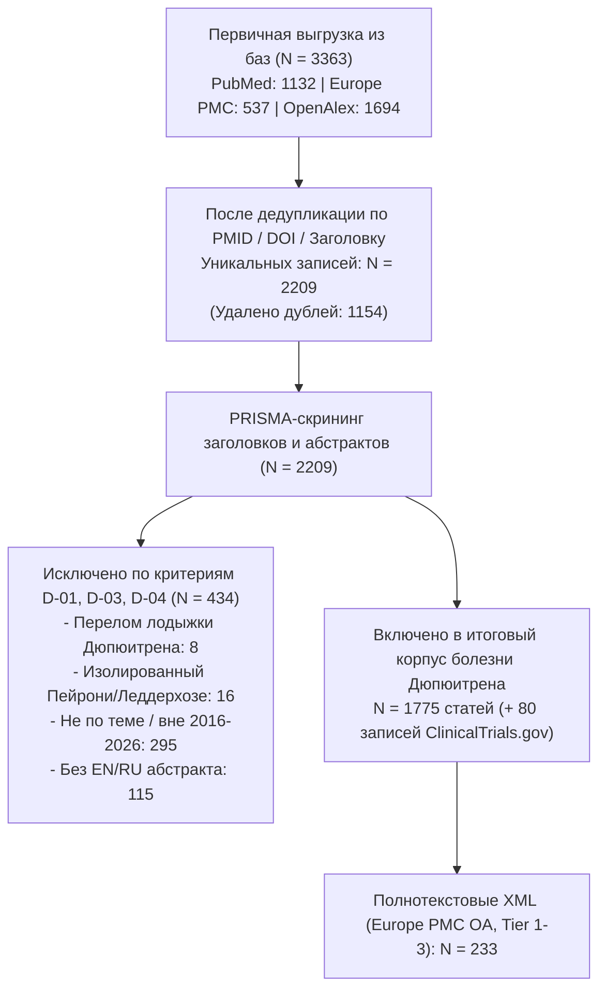

# PRISMA-статистика и карта корпуса: Контрактура Дюпюитрена (ладонный фиброматоз)

**Временной срез:** 2016–2026 гг.
**База данных:** `data/dupuytren/literature.db`

## 1. Воронка отбора публикаций (PRISMA 2020)

## 2. Стратификация по уровням доказательности (`Tier 1–4`)

| Уровень доказательности | Описание категории | Число статей | Открытый доступ (OA) | Скачано Full-Text XML |
|-------------------------|--------------------|-------------:|---------------------:|----------------------:|
| Tier 1 | **Tier 1** (Метаанализы, систематические обзоры, РКИ, гайдлайны) | 181 | 109 | 59 |
| Tier 2 | **Tier 2** (Проспективные/сравнительные когорты, GWAS, scRNA-seq, наблюдение ≥3 лет) | 192 | 122 | 47 |
| Tier 3 | **Tier 3** (Ретроспективные серии, работы *in vitro*/*ex vivo*, нарративные обзоры [133]) | 942 | 566 | 127 |
| Tier 4 | **Tier 4** (Case reports, письма, комментарии; из них редкие осложнения: 23) | 460 | 163 | 0 |

- **Включено препринтов (2023–2026, метка `[Preprint]`, D-02):** 144
- **Нарративных обзоров в Tier 3 (`D-06`, используются только для проверки полноты ссылок):** 133
- **Клинических случаев редких осложнений в Tier 4 (`D-05`):** 23

## 3. Распределение по 5 тематическим кластерам

| Кластер | Название кластера | Всего статей | Ядро доказательности (Tier 1–2) | Доступно Full-Text XML |
|---------|-------------------|-------------:|--------------------------------:|-----------------------:|
| `etiology` | Этиология, эпидемиология и генетика | 433 | 124 | 80 |
| `pathogenesis` | Молекулярный и клеточный патогенез | 649 | 199 | 124 |
| `conservative` | Консервативное и малоинвазивное лечение | 683 | 198 | 106 |
| `surgical` | Хирургическое лечение и техника операций | 526 | 146 | 75 |
| `outcomes` | Отдаленные результаты, рецидивы и осложнения | 769 | 296 | 135 |

## 4. Динамика публикаций по годам (2016–2026)

| Год | Всего включено | Tier 1 (РКИ/Мета) | Tier 2 (Когорты/Омики) | Tier 3 (Серии/In vitro/Обзоры) | Tier 4 (Кейсы/Письма) |
|----:|---------------:|------------------:|-----------------------:|-------------------------------:|----------------------:|
| 2016 | 201 | 13 | 16 | 73 | 99 |
| 2017 | 146 | 15 | 16 | 74 | 41 |
| 2018 | 160 | 20 | 21 | 89 | 30 |
| 2019 | 171 | 17 | 16 | 95 | 43 |
| 2020 | 153 | 13 | 14 | 84 | 42 |
| 2021 | 139 | 10 | 19 | 78 | 32 |
| 2022 | 150 | 12 | 12 | 93 | 33 |
| 2023 | 139 | 10 | 17 | 93 | 19 |
| 2024 | 160 | 24 | 20 | 80 | 36 |
| 2025 | 181 | 20 | 15 | 94 | 52 |
| 2026 | 175 | 27 | 26 | 89 | 33 |

## 5. Реестр клинических исследований ClinicalTrials.gov (N = 80)

| Статус исследования | Количество |
|---------------------|-----------:|
| `COMPLETED` | 44 |
| `RECRUITING` | 12 |
| `UNKNOWN` | 10 |
| `NOT_YET_RECRUITING` | 7 |
| `ACTIVE_NOT_RECRUITING` | 3 |
| `WITHDRAWN` | 2 |
| `TERMINATED` | 2 |
