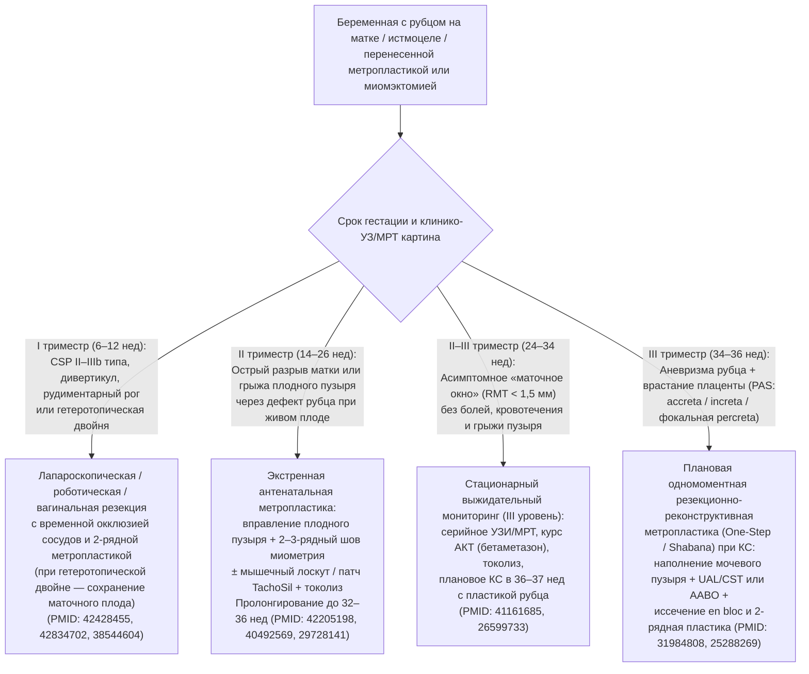

# Краткое аналитическое резюме (Executive Summary): Клинические случаи метропластики и реконструкции матки во время беременности

**Нозология:** Несостоятельный рубец на матке, антенатальная дегисценция/разрыв матки, рубцовая беременность (`CSP`), спектр врастания плаценты (`PAS`) и врожденные аномалии матки (`МКБ-10: O34.2 / O71.0 / O71.1 / Q51.1–Q51.4`)  
**Доказательная база:** `506` включенных публикаций `2006–2026` гг. (`Tier 1`: `52`, `Tier 2`: `67`, `Tier 3`: `238`, `Tier 4` клинические случаи: `149`), `46` полнотекстовых XML и `8` клинических исследований `ClinicalTrials.gov` из базы `data/metroplasty_pregnancy/literature.db`.

---

## 1. Ключевые тезисы для клинической практики

1. **Антенатальный разрыв или обширная дегисценция матки с пролабированием плодного пузыря в `14–25` недель больше не являются абсолютным приговором к прерыванию беременности или гистерэктомии.** В отобранных клинических случаях при живом плоде, отсутствии тотальной отслойки плаценты и хориоамнионита экстренное атравматичное вправление плодного пузыря с послойной двух-/трехрядной метропластикой (в том числе с укреплением мышечным лоскутом или коллагеново-фибриновым патчем `TachoSil` / сеткой `Gore-Tex`) позволяет пролонгировать беременность на **`8–15` недель** (до `32–37` нед) и добиться рождения живого ребенка в **`75–88%`** наблюдений (`PMID: 42205198`, `PMID: 29728141`, `PMID: 40492569`, `PMID: 37356016`, `PMID: 41263464`).
2. **Порог остаточной толщины миометрия `RMT = 2,5 мм` — главный критерий выбора хирургического доступа (`PMID: 33152531`).** При `RMT < 2,5 мм` изолированная гистероскопическая резекция ниши опасна перфорацией мочевого пузыря и не укрепляет стенку матки; показана лапароскопическая (`LIR`), робот-ассистированная (`RAIR / RALNR`) или трансвагинальная реконструктивная метропластика с двухрядным швом, которая увеличивает `RMT` до `5,8–7,5 мм` и дает частоту клинической беременности **`62%`** (`95% ДИ 54–69%`) у женщин с вторичным бесплодием (`PMID: 40303644`, `PMID: 40601781`, `PMID: 42509438`).
3. **Одномоментная резекционно-реконструктивная метропластика (`One-Step Conservative Surgery`) при спектре врастания плаценты (`PAS`) сохраняет матку в `79,5–91,5%` случаев (`PMID: 31984808`, `PMID: 25288269`).** Иссечение пораженного миометрия единым блоком с вросшей плацентой на фоне перевязки маточных артерий и цервикальной тампонады (`UAL + CST`, `PMID: 36117806`, `PMID: 37633887`), предварительного наполнения мочевого пузыря (`PMID: 40370756`) или баллонной окклюзии аорты (`AABO`, `PMID: 42514175`) превосходит как цезареву гистерэктомию, так и выжидательное оставление плаценты *in situ* (`PMID: 41691236`).
4. **При рубцовой беременности (`CSP` типа `II–IIIb`, `RMT < 2–3 мм`), рудиментарном роге (`U4a`) и гетеротопической корнуальной двойне методом выбора в I триместре служит резекция очага с первичной двухрядной метропластикой (`PMID: 42428455`, `PMID: 42834702`, `PMID: 36906833`, `PMID: 38544604`).** Это снижает риск рецидива `CSP` до `1,5–4,0%` и предотвращает трансформацию нелеченой `CSP` в `placenta percreta` (`PMID: 40015227`).
5. **Техника ушивания матки при первичном кесаревом сечении и миомэктомии определяет риск будущих катастроф.** Двухрядный беззахлестный эндометрий-сберегающий шов (`unlocked double-layer, endometrium-sparing`) снижает риск формирования ниши в **`5,2–8,3` раза** (`p = 0,001`, `PMID: 41865166`, `PMID: 39428032`, `NCT07611331`), а отказ от агрессивной электрокоагуляции ложа при лапароскопической/гравидарной миомэктомии в пользу многорядного шва предотвращает спонтанные разрывы матки во II триместре (`PMID: 25256675`, `PMID: 42147617`).

---

## 2. Алгоритм клинического принятия решений при дефектах миометрия у беременных

---

## 3. Сводная таблица эффективности, истинных рецидивов и процедива по 5 модальностям

| Модальность | Показания | Первичная эффективность и пролонгирование | Истинный рецидив (`True Recurrence`) | Процедив (`Disease Progression`) | Плюсы и Минусы |
| :--- | :--- | :--- | :--- | :--- | :--- |
| **1. Антенатальная метропластика во время продолжающейся беременности (`14–26` нед)** | Спонтанный разрыв матки или дегисценция с грыжей плодного пузыря при живом дожизнеспособном плоде | Пролонгирование на **`8–15` нед**; рождение живого ребенка в **`75–88%`** кейсов (`PMID: 42205198`, `PMID: 29728141`) | **`12–22%`** повторная дегисценция в III триместре; **`15–33%`** разрыв в следующей беременности (`PMID: 34946239`) | **`10–18%`** ПРПО при ушивании, отслойка плаценты или `PAS` с гистерэктомией при КС | **+** Спасает плод на сроках 15–23 нед и сохраняет матку **−** Высокий риск ПР и повторного разрыва/PAS |
| **2. Резекция `CSP`, дивертикула или рудиментарного рога с метропластикой** | `CSP` II–IIIb типа (`RMT < 3 мм`), гетеротопическая корнуальная беременность, рудиментарный рог (`U4a`) | Сохранение матки **`96–99%`**, рост `RMT` до `5,5–8,0 мм`; живорождение второго плода при двойне **`80–90%`** (`PMID: 42834702`) | **`1,5–4,0%`** повторная `CSP` или рецидив ниши (`PMID: 42428455`, `PMID: 33120815`) | **`2–5%`** кровопотеря `> 1000 мл` (без окклюзии сосудов), `1–2%` травма мочевого пузыря | **+** Ликвидирует и эктопию, и сам дефект стенки **−** Требует навыков эндовидеохирургии и МРТ |
| **3. Интранатальная метропластика при КС (`One-Step` при `PAS` и аневризме)** | Врастание плаценты (`PAS`) и полное истончение нижнего сегмента при сохранной надвлагалищной манжетке `≥ 2 см` | Сохранение матки в **`79,5–91,5%`** (`N = 452` и `N = 71`); кровопотеря `800–1400 мл` (`PMID: 31984808`, `PMID: 25288269`) | **`8–18%`** истончение рубца или повторный `PAS` в следующей гестации (`PMID: 37633887`) | **`8,5–20,5%`** переход к гистерэктомии при инвазии шейки/параметрия; `1,4%` свищи (`PMID: 38055313`) | **+** Предотвращает 80–90% гистерэктомий при `PAS` **−** Требует мультидисциплинарного центра IIIB–C |
| **4. Предгравидарная / ранняя малоинвазивная пластика (`LIR`, `RAIR`, гистероскопия)** | Симптомное истмоцеле (`RMT < 2,5 мм` — `LIR/RAIR`; `≥ 2,5 мм` — гистероскопия), перегородка (`U2`), Т-матка (`U1`) | Клиническая беременность **`62%`** после `LIR` (`PMID: 40303644`); рост живорождений с **`12%` до `71%`** (`RR 6,00`, `PMID: 38098016`) | **`3,6–8,0%`** рецидив ниши (`PMID: 42509438`); **`0%`** остаточной перегородки при `3D-УЗИ` (`PMID: 37280475`) | **`0,5–2,0%`** разрыв матки при перфорации; рост `PAS` до **`4,2%`** после криопереноса (`FET`, `PMID: 41742108`) | **+** Восстанавливает анатомию и фертильность **−** Повышает риск `PAS` в циклах `FET` |
| **5. Гравидарная миомэктомия с метропластикой и выжидательный мониторинг** | Острый некроз миомы в I–II триместре; бессимптомное «маточное окно» в 26–34 нед без грыжи пузыря | Донашивание до срока **`82–92%`** после миомэктомии (`PMID: 25256675`); **`85–95%`** успех стационарного мониторинга | **`0,5–2,0%`** разрыв ложа миомы при многорядном шве (до **`4–8%`** при электрокоагуляции; `PMID: 42147617`) | **`5–12%`** переход асимптомного окна в острый разрыв с экстренным КС (`PMID: 41161685`) | **+** Избегает лишней лапаротомии при спокойном окне **−** Стертая клиника полного разрыва (`PMID: 42699916`) |

---

## 4. Практический чек-лист хирурга при антенатальной и интранатальной метропластике

- **При выявлении грыжи плодного пузыря через дефект рубца в `16–24` нед (`PMID: 37356016`, `PMID: 40492569`):**
  - Исключить хориоамнионит (СРБ, лейкоцитоз) и отслойку плаценты; начать в/в токолиз до разреза кожи.
  - Вправить плодный пузырь влажным тупфером или раздутым катетером Фолея; при дефиците мышечной ткани использовать выкроенный миометральный лоскут (`PMID: 41263464`) или коллагеново-фибриновый патч (`PMID: 40492569`) поверх двухрядного шва полиглактином.
- **При органосохраняющей метропластике по поводу `PAS` на кесаревом сечении (`PMID: 31984808`, `PMID: 36117806`, `PMID: 40370756`):**
  - Выполнить ретроградное наполнение мочевого пузыря (`200–300 мл` физраствора) для четкой визуализации границы пузырно-маточной складки (`PMID: 40370756`).
  - Извлечь плод через разрез выше края плаценты; выполнить перевязку маточных артерий в сочетании с цервикальной тампонадой (`UAL + CST`, `PMID: 36117806`) или `AABO` (`PMID: 42514175`), иссечь измененный миометрий единым блоком с плацентой и наложить двухрядный реконструктивный шов.
- **При ушивании первичного или повторного кесарева сечения для профилактики ниши (`PMID: 41865166`, `NCT07611331`, `NCT06691750`):**
  - Применять двухрядный беззахлестный эндометрий-сберегающий шов (`unlocked double-layer, endometrium-sparing`) или безузловую анкерную нить (`barbed suture`) без включения децидуального слоя в линию шва.
