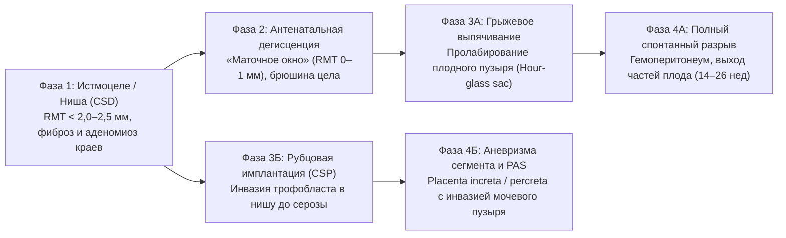

# Модуль 2. Патоморфология несостоятельного рубца, УЗ/МРТ-стратификация RMT и грыжевое выпячивание плодного пузыря

**Нозология:** Клинические случаи метропластики и реконструкции матки во время беременности (`МКБ-10: O34.2 / O71.0 / O71.1 / Q51.1–Q51.4`)  
**Доказательная база модуля:** Кластер 2 (`239` публикаций в локальной базе `data/metroplasty_pregnancy/literature.db`, включая `56` работ уровней `Tier 1–2` и `23` полнотекстовых XML).

---

## 1. Патоморфологический континуум: от ниши рубца до полного разрыва беременной матки

В отличие от острого интранатального разрыва матки в родах, антенатальная декомпенсация рубца во время беременности развивается стадийно под действием нарастающего гидростатического давления плодного пузыря (закон Лапласа: $T = P \cdot r / (2 \cdot h)$, где при уменьшении толщины стенки $h$ напряжение на разрыв $T$ стремится к бесконечности):

### Принципиальное клинико-морфологическое разграничение
1. **Неполный разрыв / антенатальная дегисценция («маточное окно», `uterine window / scar dehiscence`):** мышечный слой (миометрий) расходится полностью на участке от `2` до `8–10` см, но покрывающая его висцеральная брюшина (пузырно-маточная складка) и подлежащие хориоамниотические оболочки остаются интактными (`PMID: 37356016`, `PMID: 41263464`). Кровотечение в брюшную полость отсутствует, сердцебиение плода не страдает.
2. **Грыжевое пролабирование плодного пузыря (`amniotic sac herniation / protrusion`):** через дефект миометрия амниотический мешок (нередко содержащий мелкие части плода или петли пуповины) выпячивается под тонкую серозную оболочку или в дефект широкой связки / послеоперационной грыжи (`PMID: 37356016`, `PMID: 40492569`, `PMID: 38489687`). Без хирургического ушивания или бандажирования стенки матки малейшее повышение внутриматочного давления приводит к разрыву оболочек (ПРПО) или полному разрыву матки.
3. **Полный антенатальный разрыв матки (`complete uterine rupture`):** нарушение целостности всех слоев стенки матки, включая висцеральную брюшину, с излитием крови и околоплодных вод в свободную брюшную полость (`PMID: 42205198`, `PMID: 29728141`, `PMID: 34729680`). При локализации разрыва в области дна (после миомэктомии или гистероскопии) или задней стенки клиническая картина может быть стертой (прикрытие сальником или петлями кишечника), что затрудняет раннюю диагностику (`PMID: 42699916`, `PMID: 41161685`).

---

## 2. Лучевая диагностика и стратификация риска (ТВУЗИ, Соногистерография, 3D-УЗИ, МРТ)

Точная оценка остаточной толщины миометрия (`Residual Myometrial Thickness, RMT`) и топографии плаценты определяет выбор между консервативным наблюдением, малоинвазивной пластикой и открытой метропластикой (`PMID: 33152531`, `PMID: 41737409`, `NCT05996926`):

| Метод визуализации | Ключевые диагностические критерии и пороговые значения | Клиническая интерпретация и выбор доступа | Источники |
| :--- | :--- | :--- | :--- |
| **Экспертное ТВУЗИ и соногистерография (SIS / 3D-TVS)** | Измерение `RMT`, глубины, ширины и объема ниши; порог высокого риска дегисценции — **`RMT < 2,0–2,5 мм`** | При `RMT ≥ 2,5–3,0 мм` допустима гистероскопическая резекция краев ниши; при **`RMT < 2,5 мм`** показана лапароскопическая, роботическая или вагинальная реконструктивная метропластика с двухрядным швом | `PMID: 33152531`, `PMID: 38853455`, `NCT05996926` |
| **Стратификация рубцовой беременности (Ban et al., 2023 и МРТ-классификация)** | **Тип I:** `RMT > 3 мм`; **Тип II:** `RMT 1–3 мм`; **Тип IIIa/IIIb:** `RMT < 1–3 мм`, диаметр плодного мешка `MSD ≥ 3 см`, выбухание в сторону мочевого пузыря и богатая сосудистая сеть | При типе `IIIb` изолированный кюретаж противопоказан из-за профузного кровотечения; показана лапароскопическая или вагинальная резекция с временной окклюзией маточных артерий и метропластикой | `PMID: 42428455`, `PMID: 41737409`, `PMID: 38544604` |
| **УЗ-протокол и МРТ при спектре врастания плаценты (PAS)** | Исчезновение гипоэхогенной ретроплацентарной зоны, плацентарные лакуны (`Grade 2–3`, `p < 0,001`), сосуды-мостики (`bridging vessels`, `p = 0,027`), гиперваскуляризация пузырно-маточного сплетения | Антенатальная верификация `PAS` снижает интраоперационную кровопотерю с `1000` до `300` мл (`p < 0,001`) за счет маршрутизации в центр III уровня и планирования одномоментной резекционной метропластики | `PMID: 34225385`, `PMID: 34086797`, `PMID: 41691236`, `PMID: 37633887` |
| **Интраоперационная навигация (3D-УЗИ и ICG / Firefly)** | Трехмерная сонография в реальном времени при рассечении перегородки; трансиллюминация ниши индоцианином зеленым (`ICG`) и чашкой `KOH` при робот-ассистированной пластике | Снижает частоту остаточной перегородки `> 10 мм` с `10,5–26%` до `0%` (`p = 0,04`) и позволяет прецизионно иссечь фиброзные края истмоцеле без травмы мочевого пузыря | `PMID: 37280475`, `PMID: 39549117`, `PMID: 40182344`, `PMID: 40550873` |

---

## 3. Клинические маски антенатального разрыва и «красные флаги» декомпенсации

По данным десятилетнего анализа полных разрывов матки в третичном акушерском стационаре (`Hu et al., 2025`, `PMID: 41161685`) и серий клинических случаев (`PMID: 34729680`, `PMID: 42699916`), классическая триада (острая кинжальная боль, прекращение схваток и брадикардия плода) во II триместре вне родовой деятельности встречается менее чем в половине наблюдений. Врачу необходимо ориентироваться на ранние предикторы:
- **Локальная пальпаторная болезненность в проекции рубца** или некупируемая тупая боль в надлобковой области при отсутствии регулярных схваток (`PMID: 38762958`, `PMID: 42699916`).
- **Симптомы диафрагмального раздражения (боль в эпигастрии, правом подреберье или плече)** на фоне скрытого гемоперитонеума при разрыве дна матки после миомэктомии или гистероскопии (`PMID: 42147617`, `PMID: 29728141`).
- **Острая задержка мочи и ущемление беременной матки (`incarcerated gravid uterus`)** в ретроверсии с перерастяжением передней стенки и расхождением старого рубца от КС во II триместре (`PMID: 40492569`).
- **Макрогематурия и внезапное уменьшение объема мочевого пузыря** при спонтанном прорастании и разрыве стенки матки и мочевого пузыря на фоне `placenta percreta` в `20–26` недель (`PMID: 41743824`, `PMID: 39397440`).
