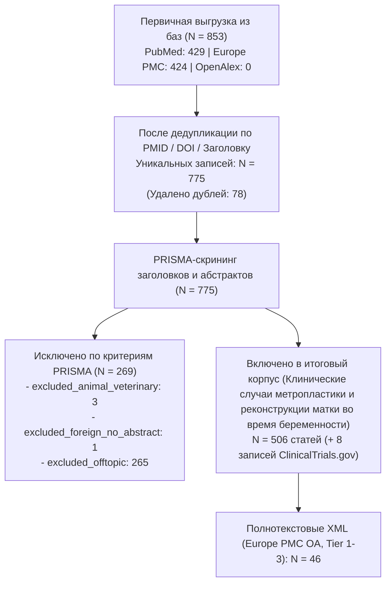

# PRISMA-статистика и карта корпуса: Клинические случаи метропластики и реконструкции матки во время беременности

**Временной срез:** 2006–2026 гг.
**База данных:** `data/metroplasty_pregnancy/literature.db`

## 1. Воронка отбора публикаций (PRISMA 2020)

## 2. Стратификация по уровням доказательности (`Tier 1–4`)

| Уровень доказательности | Описание категории | Число статей | Открытый доступ (OA) | Скачано Full-Text XML |
|-------------------------|--------------------|-------------:|---------------------:|----------------------:|
| Tier 1 | **Tier 1** (Метаанализы, систематические обзоры, РКИ, гайдлайны) | 52 | 18 | 8 |
| Tier 2 | **Tier 2** (Проспективные/сравнительные когорты, GWAS, scRNA-seq, наблюдение ≥3 лет) | 67 | 29 | 18 |
| Tier 3 | **Tier 3** (Ретроспективные серии, работы *in vitro*/*ex vivo*, нарративные обзоры [47]) | 238 | 106 | 20 |
| Tier 4 | **Tier 4** (Case reports, письма, комментарии; из них редкие осложнения: 75) | 149 | 92 | 0 |

- **Включено препринтов (2023–2026, метка `[Preprint]`, D-02):** 0
- **Нарративных обзоров в Tier 3 (`D-06`, используются только для проверки полноты ссылок):** 47
- **Клинических случаев редких осложнений в Tier 4 (`D-05`):** 75

## 3. Распределение по 5 тематическим кластерам

| Кластер | Название кластера | Всего статей | Ядро доказательности (Tier 1–2) | Доступно Full-Text XML |
|---------|-------------------|-------------:|--------------------------------:|-----------------------:|
| `etiology` | Этиология дефектов миометрия, факторы риска дегисценции и предшествующие метропластики | 338 | 74 | 39 |
| `pathogenesis` | Патоморфология несостоятельного рубца, МРТ/УЗ-семиотика и грыжевое выпячивание плодного пузыря | 239 | 56 | 23 |
| `conservative` | Консервативно-выжидательное ведение при бессимптомной дегисценции и предгравидарная пластика | 238 | 64 | 30 |
| `surgical` | Клинические случаи антенатальной и интранатальной метропластики во время беременности | 191 | 35 | 14 |
| `outcomes` | Перинатальные и материнские исходы, пролонгирование гестации, рецидивы разрыва и процедив в PAS/гистерэктомию | 304 | 75 | 23 |

## 4. Динамика публикаций по годам (2016–2026)

| Год | Всего включено | Tier 1 (РКИ/Мета) | Tier 2 (Когорты/Омики) | Tier 3 (Серии/In vitro/Обзоры) | Tier 4 (Кейсы/Письма) |
|----:|---------------:|------------------:|-----------------------:|-------------------------------:|----------------------:|
| 2006 | 12 | 2 | 1 | 7 | 2 |
| 2007 | 11 | 3 | 0 | 5 | 3 |
| 2008 | 4 | 1 | 1 | 0 | 2 |
| 2009 | 13 | 1 | 0 | 8 | 4 |
| 2010 | 16 | 4 | 0 | 10 | 2 |
| 2011 | 12 | 2 | 1 | 8 | 1 |
| 2012 | 16 | 0 | 3 | 10 | 3 |
| 2013 | 23 | 4 | 1 | 8 | 10 |
| 2014 | 17 | 1 | 3 | 10 | 3 |
| 2015 | 21 | 1 | 7 | 5 | 8 |
| 2016 | 19 | 1 | 4 | 8 | 6 |
| 2017 | 13 | 0 | 0 | 7 | 6 |
| 2018 | 17 | 1 | 0 | 9 | 7 |
| 2019 | 21 | 3 | 5 | 9 | 4 |
| 2020 | 31 | 4 | 3 | 15 | 9 |
| 2021 | 35 | 7 | 1 | 17 | 10 |
| 2022 | 51 | 5 | 7 | 26 | 13 |
| 2023 | 32 | 0 | 9 | 15 | 8 |
| 2024 | 39 | 2 | 3 | 15 | 19 |
| 2025 | 48 | 5 | 8 | 23 | 12 |
| 2026 | 55 | 5 | 10 | 23 | 17 |

## 5. Реестр клинических исследований ClinicalTrials.gov (N = 8)

| Статус исследования | Количество |
|---------------------|-----------:|
| `COMPLETED` | 4 |
| `UNKNOWN` | 2 |
| `RECRUITING` | 2 |
