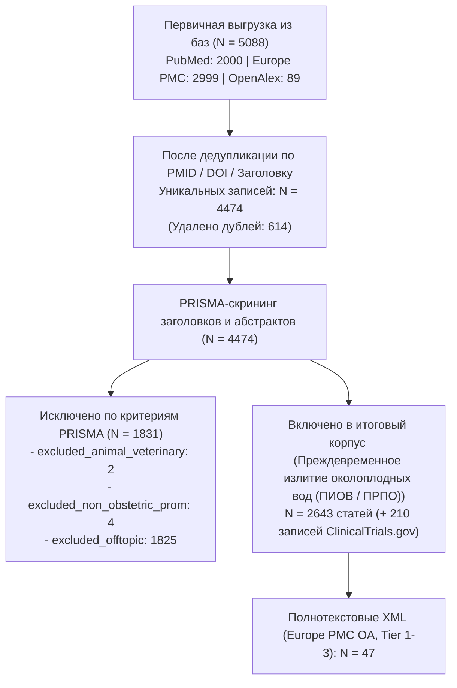

# PRISMA-статистика и карта корпуса: Преждевременное излитие околоплодных вод (ПИОВ / ПРПО)

**Временной срез:** 2016–2026 гг.
**База данных:** `data/prom/literature.db`

## 1. Воронка отбора публикаций (PRISMA 2020)

## 2. Стратификация по уровням доказательности (`Tier 1–4`)

| Уровень доказательности | Описание категории | Число статей | Открытый доступ (OA) | Скачано Full-Text XML |
|-------------------------|--------------------|-------------:|---------------------:|----------------------:|
| Tier 1 | **Tier 1** (Метаанализы, систематические обзоры, РКИ, гайдлайны) | 440 | 209 | 47 |
| Tier 2 | **Tier 2** (Проспективные/сравнительные когорты, GWAS, scRNA-seq, наблюдение ≥3 лет) | 638 | 352 | 0 |
| Tier 3 | **Tier 3** (Ретроспективные серии, работы *in vitro*/*ex vivo*, нарративные обзоры [159]) | 1374 | 903 | 0 |
| Tier 4 | **Tier 4** (Case reports, письма, комментарии; из них редкие осложнения: 32) | 191 | 151 | 0 |

- **Включено препринтов (2023–2026, метка `[Preprint]`, D-02):** 16
- **Нарративных обзоров в Tier 3 (`D-06`, используются только для проверки полноты ссылок):** 159
- **Клинических случаев редких осложнений в Tier 4 (`D-05`):** 32

## 3. Распределение по 5 тематическим кластерам

| Кластер | Название кластера | Всего статей | Ядро доказательности (Tier 1–2) | Доступно Full-Text XML |
|---------|-------------------|-------------:|--------------------------------:|-----------------------:|
| `etiology` | Этиология, эпидемиология, микробиом и факторы риска | 1710 | 677 | 29 |
| `pathogenesis` | Молекулярный патогенез, старение оболочек и биомаркеры | 409 | 145 | 11 |
| `conservative` | Выжидательная тактика, антибиотики, токолиз и нейропротекция | 766 | 294 | 6 |
| `surgical` | Индукция родов, кесарево сечение, серкляж и фетальные вмешательства | 874 | 381 | 17 |
| `outcomes` | Материнские и перинатальные исходы, осложнения, рецидивы и процедив | 1776 | 781 | 44 |

## 4. Динамика публикаций по годам (2016–2026)

| Год | Всего включено | Tier 1 (РКИ/Мета) | Tier 2 (Когорты/Омики) | Tier 3 (Серии/In vitro/Обзоры) | Tier 4 (Кейсы/Письма) |
|----:|---------------:|------------------:|-----------------------:|-------------------------------:|----------------------:|
| 2016 | 10 | 0 | 1 | 4 | 5 |
| 2017 | 5 | 0 | 0 | 4 | 1 |
| 2018 | 98 | 23 | 28 | 40 | 7 |
| 2019 | 148 | 28 | 53 | 56 | 11 |
| 2020 | 218 | 33 | 71 | 104 | 10 |
| 2021 | 257 | 45 | 70 | 131 | 11 |
| 2022 | 286 | 53 | 54 | 164 | 15 |
| 2023 | 268 | 50 | 62 | 141 | 15 |
| 2024 | 322 | 57 | 68 | 177 | 20 |
| 2025 | 505 | 79 | 115 | 264 | 47 |
| 2026 | 526 | 72 | 116 | 289 | 49 |

## 5. Реестр клинических исследований ClinicalTrials.gov (N = 210)

| Статус исследования | Количество |
|---------------------|-----------:|
| `COMPLETED` | 81 |
| `UNKNOWN` | 63 |
| `RECRUITING` | 22 |
| `TERMINATED` | 16 |
| `WITHDRAWN` | 11 |
| `NOT_YET_RECRUITING` | 10 |
| `ACTIVE_NOT_RECRUITING` | 5 |
| `ENROLLING_BY_INVITATION` | 2 |
