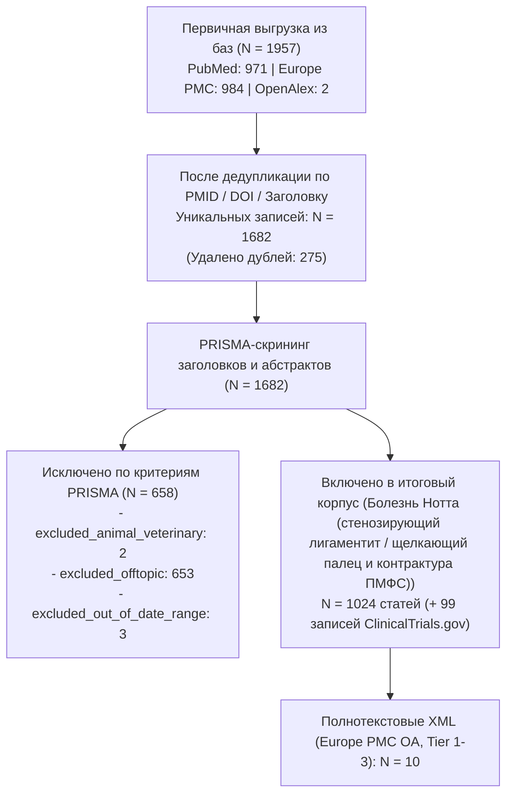

# PRISMA-статистика и карта корпуса: Болезнь Нотта (стенозирующий лигаментит / щелкающий палец и контрактура ПМФС)

**Временной срез:** 2010–2026 гг.
**База данных:** `data/trigger_finger/literature.db`

## 1. Воронка отбора публикаций (PRISMA 2020)

## 2. Стратификация по уровням доказательности (`Tier 1–4`)

| Уровень доказательности | Описание категории | Число статей | Открытый доступ (OA) | Скачано Full-Text XML |
|-------------------------|--------------------|-------------:|---------------------:|----------------------:|
| Tier 1 | **Tier 1** (Метаанализы, систематические обзоры, РКИ, гайдлайны) | 166 | 67 | 9 |
| Tier 2 | **Tier 2** (Проспективные/сравнительные когорты, GWAS, scRNA-seq, наблюдение ≥3 лет) | 144 | 71 | 1 |
| Tier 3 | **Tier 3** (Ретроспективные серии, работы *in vitro*/*ex vivo*, нарративные обзоры [91]) | 528 | 283 | 0 |
| Tier 4 | **Tier 4** (Case reports, письма, комментарии; из них редкие осложнения: 29) | 186 | 114 | 0 |

- **Включено препринтов (2023–2026, метка `[Preprint]`, D-02):** 0
- **Нарративных обзоров в Tier 3 (`D-06`, используются только для проверки полноты ссылок):** 91
- **Клинических случаев редких осложнений в Tier 4 (`D-05`):** 29

## 3. Распределение по 5 тематическим кластерам

| Кластер | Название кластера | Всего статей | Ядро доказательности (Tier 1–2) | Доступно Full-Text XML |
|---------|-------------------|-------------:|--------------------------------:|-----------------------:|
| `etiology` | Этиология, эпидемиология, метаболические факторы риска (СД, гипотиреоз, КТС) и анатомия пальцев | 594 | 159 | 5 |
| `pathogenesis` | Патоморфология узла Нотта и связки A1, биомеханика хиазмы Кампера и генез контрактуры и боли в ПМФС (PIP joint) | 347 | 88 | 3 |
| `conservative` | Естественное течение и консервативное лечение (инъекции ГКС, ортезирование ПМФС/ПФС, УВТ, НПВС, гиалуроновая кислота, реабилитация) | 379 | 146 | 6 |
| `surgical` | Хирургические модальности: открытая, чрескожная и УЗ-ассистированная лигаментотомия A1, резекция ножки FDS и релиз контрактуры ПМФС | 397 | 121 | 3 |
| `outcomes` | Динамика боли и дефицита разгибания ПМФС до и после операции (феномен 6 месяцев), истинные рецидивы, процедив и осложнения | 434 | 160 | 5 |

## 4. Динамика публикаций по годам (2016–2026)

| Год | Всего включено | Tier 1 (РКИ/Мета) | Tier 2 (Когорты/Омики) | Tier 3 (Серии/In vitro/Обзоры) | Tier 4 (Кейсы/Письма) |
|----:|---------------:|------------------:|-----------------------:|-------------------------------:|----------------------:|
| 2010 | 31 | 2 | 1 | 19 | 9 |
| 2011 | 28 | 5 | 2 | 14 | 7 |
| 2012 | 37 | 5 | 3 | 22 | 7 |
| 2013 | 36 | 2 | 6 | 20 | 8 |
| 2014 | 44 | 4 | 6 | 26 | 8 |
| 2015 | 40 | 7 | 5 | 15 | 13 |
| 2016 | 43 | 3 | 14 | 22 | 4 |
| 2017 | 43 | 6 | 4 | 23 | 10 |
| 2018 | 45 | 12 | 8 | 16 | 9 |
| 2019 | 62 | 13 | 11 | 32 | 6 |
| 2020 | 52 | 9 | 4 | 29 | 10 |
| 2021 | 66 | 12 | 5 | 39 | 10 |
| 2022 | 87 | 13 | 11 | 43 | 20 |
| 2023 | 102 | 20 | 16 | 51 | 15 |
| 2024 | 84 | 12 | 16 | 38 | 18 |
| 2025 | 111 | 23 | 13 | 58 | 17 |
| 2026 | 113 | 18 | 19 | 61 | 15 |

## 5. Реестр клинических исследований ClinicalTrials.gov (N = 99)

| Статус исследования | Количество |
|---------------------|-----------:|
| `COMPLETED` | 46 |
| `UNKNOWN` | 19 |
| `RECRUITING` | 9 |
| `TERMINATED` | 7 |
| `NOT_YET_RECRUITING` | 7 |
| `WITHDRAWN` | 4 |
| `ENROLLING_BY_INVITATION` | 3 |
| `ACTIVE_NOT_RECRUITING` | 3 |
| `SUSPENDED` | 1 |
